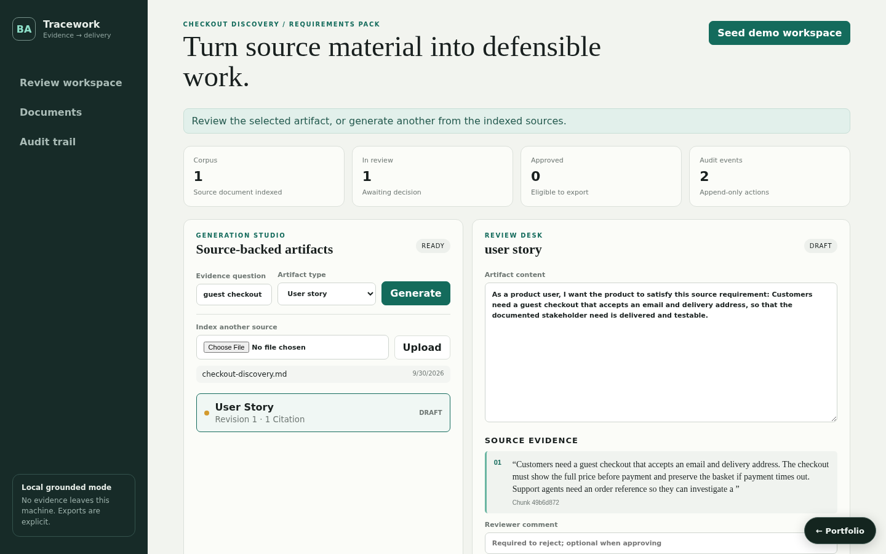

# Agentic BA Automation Platform

A locally runnable requirements workspace that ingests stakeholder evidence, retrieves relevant chunks, creates six kinds of source-backed engineering artifacts, enforces review transitions, exports approved work, and records an audit trail.



## What works

- Text, Markdown, HTML, PDF, and DOCX extraction with a 5 MiB API boundary. When a browser sends no MIME type (common for `.md`), the file extension decides; a missing PDF/DOCX parser is reported as an error instead of being indexed.
- Stable overlapping chunks and deterministic lexical retrieval.
- Grounded user stories, acceptance criteria, risks, assumptions, process summaries, and implementation tickets. The offline generator is explicitly deterministic; it is not presented as an LLM.
- Exact chunk quotes on every generated artifact and a refusal when no evidence matches.
- Edit/revision, rejection rationale, approval guards, immutable exported artifacts, Jira/JSON output, and an optional real GitHub Issues call only when `AGENTIC_BA_ALLOW_REMOTE_EXPORT=true`, `GITHUB_TOKEN`, and `GITHUB_REPOSITORY` are all set (inherited credentials alone never trigger a remote call).
- Documents, artifacts, filtered audit events, seeded evidence, and a responsive review console (branded Tracework) that lists indexed sources, takes a reviewer comment (required to reject), and blocks approval while edits are unsaved.

## Run locally

```bash
python3 -m venv .venv
. .venv/bin/activate
pip install -r requirements.txt -r requirements-dev.txt
PYTHONPATH=src uvicorn agentic_ba_automation_platform.api.app:app --reload --port 8001
```

In another terminal:

```bash
cd frontend
npm install
npm run dev
```

Open `http://localhost:5173` and choose **Seed demo workspace**. The Vite server proxies `/api` to port 8001. Alternatively, `docker compose up` starts the API and frontend with state in a SQLite volume. See [Persistence](#persistence).

## Main API workflow

1. `POST /api/demo/seed` or `POST /api/upload` indexes evidence.
2. `POST /api/generate` retrieves matching chunks and creates a cited draft.
3. `PATCH /api/artifacts/{id}` creates a new revision.
4. `PUT /api/artifacts/{id}/status` approves or rejects with guarded transitions.
5. `POST /api/artifacts/{id}/export` emits `json`, `jira`, or `github`; GitHub without the explicit opt-in and credentials returns a clearly labeled preview and does not mark the artifact exported.
6. `GET /api/audit` proves ingestion, generation, edit, review, and export actions.

## Verification

```bash
PYTHONPATH=src python3 -m pytest tests/unit tests/integration
cd frontend && npm run build
```

The integration suite covers the complete ingest → generate → review → export → audit path and invalid transitions. See [architecture](docs/architecture.md), [testing strategy](docs/testing-strategy.md), and [demo script](docs/demo-script.md).

## Security and failure boundaries

Uploads are type/size checked, empty extraction is rejected, citations are local, reviewer/export state is enforced server-side, and tokens are read only from the environment. The local demo uses caller-supplied actor IDs for ease of evaluation; production deployment must put the API behind OIDC/workspace authorization and replace the in-process repository with the included persistence boundary.

External GitHub failures retain the approved artifact and return an actionable error. Parser errors never become indexed source content. No source is sent to a remote model in the default path.

## Persistence

State is in memory by default, so the project runs with no setup. Set `AGENTIC_BA_AUTOMATION_PLATFORM_DATABASE_URL` to persist it:

```bash
AGENTIC_BA_AUTOMATION_PLATFORM_DATABASE_URL=sqlite:///./.local/state.sqlite3                          # single file
AGENTIC_BA_AUTOMATION_PLATFORM_DATABASE_URL=postgresql+psycopg2://<user>:<password>@<host>:5432/<db>   # PostgreSQL
```

On startup the service restores its collections (`documents`, `chunks`, `artifacts`, `audit_logs`); after every successful write request it saves the documents that changed, and deletes removed ones, in one transaction. `docker compose up` uses SQLite on a named volume. For PostgreSQL, copy `.env.example` to `.env`, choose a `POSTGRES_PASSWORD`, and run `docker compose -f docker-compose.yml -f compose.postgres.yml up`; Compose refuses to start without the password, and no credential is committed. `tests/integration/test_persistence_restart.py` proves that state written by one process is served by a fresh process; set `PERSISTENCE_TEST_DATABASE_URL` to run it against PostgreSQL.
