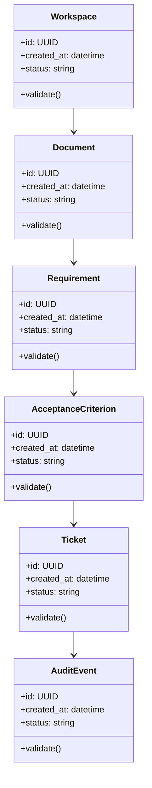

# Algorithms and Data Structures

## Implemented Algorithms

| # | Algorithm | Delivery Evidence |
|---|---|---|
| 1 | document chunking with overlap windows | Implemented with parser and boundary tests |
| 2 | deterministic lexical evidence retrieval | Implemented with relevance/no-evidence tests |
| 3 | edit/reject/approve/export state machine | Implemented with conflict and terminal-state tests |
| 4 | six-type grounded artifact generation | Implemented with seeded end-to-end workflow tests |
| 5 | exact source-citation coverage | Implemented with quote and chunk-ID assertions |

## Core Data Structures

| Structure | Purpose | Notes |
|---|---|---|
| `RequirementGraph` | Core data structure for Agentic BA Automation Platform | Document invariants and serialization format |
| `ChunkIndex` | Core data structure for Agentic BA Automation Platform | Document invariants and serialization format |
| `PromptVersion` | Core data structure for Agentic BA Automation Platform | Document invariants and serialization format |
| `ApprovalState` | Core data structure for Agentic BA Automation Platform | Document invariants and serialization format |
| `AuditEvent` | Core data structure for Agentic BA Automation Platform | Document invariants and serialization format |

## UML-Style Domain View

## Complexity Targets

- Prefer linear or near-linear processing for ingestion and validation steps.
- Use indexed lookup structures for repeated retrieval, policy, and ownership checks.
- Keep expensive AI/model calls outside tight loops.
- Cache deterministic intermediate results with versioned keys.

## Required Tests

- Happy-path unit tests for each algorithm.
- Boundary tests for empty input, malformed input, duplicate input, and large input.
- Regression tests for known failure modes.
- Deterministic seed tests for synthetic data, simulation, or model evaluation.
- Contract tests for serialized data structures.

## Implementation Notes

The delivered workflow parses evidence, retrieves matching chunks, creates cited artifacts, enforces review transitions, exports approved work, and records audit events through both API and web console.
