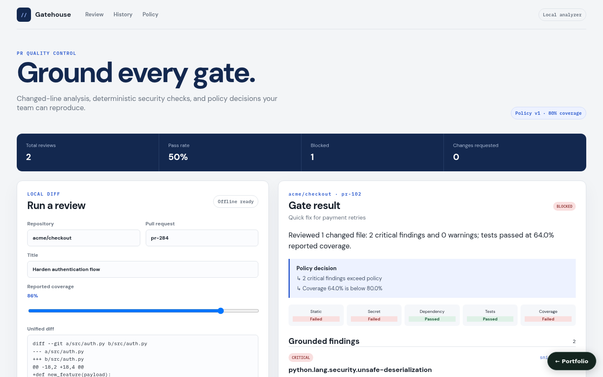

# AI Code Review and Test Gatekeeper

**Project 06 · Locally runnable product**



Gatehouse reviews unified diffs on new-file coordinates, normalizes reproducible findings, and explains why a pull request is approved, needs changes, or is blocked. It works offline after dependencies are installed and never claims that a hosted LLM or GitHub check ran.

## Complete workflow

- Parse plain snippets or multi-file unified diffs while ignoring removed lines and preserving added-line coordinates.
- Detect dangerous `eval`, unsafe deserialization (`pickle.load(s)`, `yaml.load` without `SafeLoader`), debug logging, hard-coded credentials, insecure dependency pins, and test-failure evidence. These are pattern rules on added lines, not full static analysis.
- Report a per-analyzer status (static, secret, dependency, tests, coverage) derived from the findings: failed on a critical finding or failing tests, warning on warnings only or coverage below 80%.
- Fingerprint/deduplicate findings with tool, rule, category, severity, path, line, remediation, and provenance.
- Produce deterministic grounded summaries and missing-test guidance tied to changed lines.
- Apply test, critical severity, warning, and 80% coverage gates with machine-readable reasons. Failed tests or critical findings block; a blocked review still lists the coverage and warning reasons so authors see everything to fix. Coverage and test results are reported by the submitter, not measured by Gatehouse.
- Deduplicate the same repo/PR/head review (or, without a head SHA, the same diff and reported results), filter history by repository/status/severity, and show pass rate and recurring rules in the React dashboard.

## Run locally

```bash
docker compose up --build
```

Open `http://localhost:5173`; API documentation is at `http://localhost:8007/docs`.

```bash
PYTHONPATH=src pytest -q
cd frontend && npm run build
```

## Trust boundary

The built-in analyzers are deterministic local adapters, not substitutes for full Semgrep/OSV/test-runner coverage. Their normalized result contract is ready for sandboxed external tools. `/api/webhook/pr` preserves SCM adapter compatibility but local mode does not publish checks; production must add verified webhook signatures, installation authorization, durable storage, and isolated runners. Optional AI wording must validate citations and fall back to the local reviewer.

## Key files

- `algorithms/analyzers.py` — unified-diff mapping and local rules
- `algorithms/llm_reviewer.py` — credential-free grounded review writer
- `algorithms/policy_engine.py` — explainable merge gate
- `services/review_service.py` — idempotency, history filters, and trends
- `frontend/src/App.tsx` — review submission and evidence dashboard

## Persistence

State is in memory by default, so the project runs with no setup. Set `AI_CODE_REVIEW_DATABASE_URL` to persist it:

```bash
AI_CODE_REVIEW_DATABASE_URL=sqlite:///./.local/state.sqlite3                          # single file
AI_CODE_REVIEW_DATABASE_URL=postgresql+psycopg2://<user>:<password>@<host>:5432/<db>   # PostgreSQL
```

On startup the service restores its collections (`reports`, `idempotency`); after every successful write request it saves the documents that changed, and deletes removed ones, in one transaction. `docker compose up` uses SQLite on a named volume. For PostgreSQL, copy `.env.example` to `.env`, choose a `POSTGRES_PASSWORD`, and run `docker compose -f docker-compose.yml -f compose.postgres.yml up`; Compose refuses to start without the password, and no credential is committed. `tests/integration/test_persistence_restart.py` proves that state written by one process is served by a fresh process; set `PERSISTENCE_TEST_DATABASE_URL` to run it against PostgreSQL.
