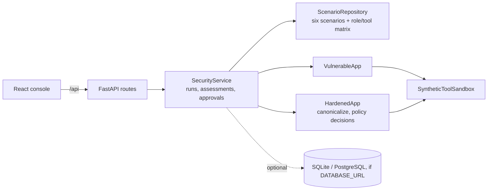

# Architecture

AgentShield Lab is one FastAPI service plus a React console. A deterministic rule engine (no language model) plays two agents: an intentionally vulnerable one and a hardened one. Every tool they can call is a synthetic in-memory fixture.

## Components

| Module | Responsibility |
|---|---|
| `adapters/repositories.py` | Six versioned scenarios (direct and indirect injection, insecure output, data leakage, excessive agency, weak tool permissions) with payloads, threats, expected outcomes, and the role/tool matrix. |
| `algorithms/apps.py` | `VulnerableApp` follows the input and reports whether the payload actually achieved the attack. `HardenedApp` applies NFKC canonicalization, injection patterns, retrieval quarantine, HTML encoding, a virtual-path allowlist, read-only SQL, role-based tool authorization, and approval gates, and records each decision with a control ID. |
| `algorithms/tools.py` | Synthetic file, SQL, search, and ticket tools; they never touch the host, network, or a database. |
| `services/security_service.py` | Stores runs, creates one-time approvals, runs the 12-check assessment, lists and exports reports, aggregates metrics. |

## Main workflow

1. `GET /api/scenarios` loads the catalog.
2. `POST /api/execute/{id}` runs one mode with an optional custom payload and role.
3. Hardened excessive-agency and admin ticket requests create a pending approval; `POST /api/approvals/{id}/resolve` then `/execute` consumes it once.
4. `POST /api/assessment` runs every scenario in both modes with the default payloads; `GET /api/assessments` lists stored reports and `/assessment/{id}/export` returns Markdown or JSON.

## Boundaries

- Detection is rule-based and covers the patterns in the catalog; it is a teaching aid, not a complete defense against prompt injection.
- Runs, reports, and approvals are in memory unless a database URL is configured.
