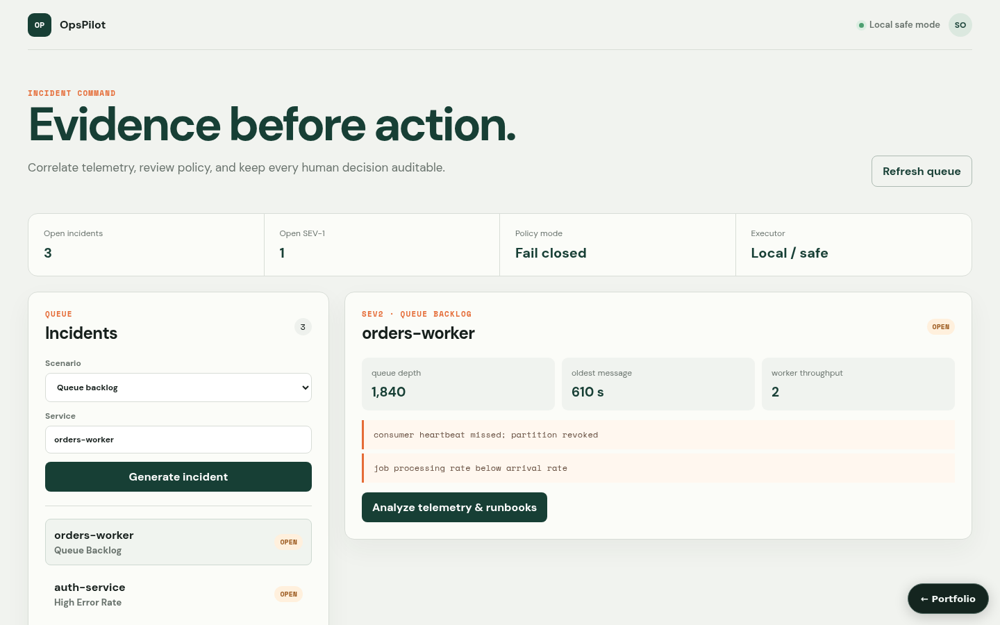

# AIOps Incident Assistant with Human Approval

**Project 05 · Locally runnable product**



OpsPilot turns four repeatable operational scenarios into evidence-grounded remediation plans. It keeps policy, human decision, execution, audit, and post-incident reporting as separate lifecycle steps. The default executor never starts a subprocess: it accepts only catalogued Kubernetes-shaped actions and returns deterministic local evidence.

## Complete workflow

- Generate latency, dependency, error-rate, and queue-backlog incidents with fixed, synthetic scenario-specific logs, metrics, and traces.
- Select a root-cause hypothesis per scenario with a rule-based confidence (fixed values adjusted by metric thresholds, not a trained model), four evidence types, and a runbook reference matched by incident type (runbook names only; their contents are not bundled).
- Mark dangerous or out-of-catalog commands blocked before approval.
- Approve or reject with actor and reason; reject duplicate or invalid transitions (409) and out-of-range action indexes (422).
- Reopen the latest plan revision (`GET /api/incidents/{id}/plans`) and a resolved incident's report (`GET /api/reports?incident_id=`), so the console keeps pending decisions when you switch incidents.
- Execute approved catalog actions through `LocalSafeExecutor`, resolve terminal plans, retain audit events, and export Markdown reports.
- Operate the entire workflow from the responsive React incident console.

## Run locally

```bash
docker compose up --build
```

Open `http://localhost:5173`; API documentation is at `http://localhost:8006/docs`.

Without Docker:

```bash
python -m pip install -r requirements-dev.txt
PYTHONPATH=src uvicorn aiops_incident_assistant_human_approval.api.app:app --port 8006
cd frontend && npm install && npm run dev
```

## Verify

```bash
PYTHONPATH=src pytest -q
cd frontend && npm run build
```

The integration suite proves create → analyze → policy denial → approve/execute → resolve → audit → export, plus rejection and duplicate-decision safety.

## Safety and adapter boundary

Without a database URL, state is process-scoped so the demo stays deterministic and credential-free; with one, incidents, plans, reports, and audit events persist (see [Persistence](#persistence)). `LocalSafeExecutor` is an explicit local adapter, not a claim of cluster execution; an authenticated Kubernetes adapter can replace it without changing lifecycle rules. Never connect an arbitrary-shell executor to this API.

## Key files

- `src/.../services/incident_service.py` — lifecycle and audit orchestration
- `src/.../algorithms/ai_agent.py` — deterministic evidence-grounded analysis
- `src/.../algorithms/policy_engine.py` — allow/deny evaluation
- `src/.../adapters/executor.py` — non-shell local executor
- `frontend/src/App.tsx` — operator console

## Persistence

State is in memory by default, so the project runs with no setup. Set `AIOPS_INCIDENT_ASSISTANT_DATABASE_URL` to persist it:

```bash
AIOPS_INCIDENT_ASSISTANT_DATABASE_URL=sqlite:///./.local/state.sqlite3                          # single file
AIOPS_INCIDENT_ASSISTANT_DATABASE_URL=postgresql+psycopg2://<user>:<password>@<host>:5432/<db>   # PostgreSQL
```

On startup the service restores its collections (`incidents`, `plans`, `reports`, `audit_events`); after every successful write request it saves the documents that changed, and deletes removed ones, in one transaction. `docker compose up` uses SQLite on a named volume. For PostgreSQL, copy `.env.example` to `.env`, choose a `POSTGRES_PASSWORD`, and run `docker compose -f docker-compose.yml -f compose.postgres.yml up`; Compose refuses to start without the password, and no credential is committed. `tests/integration/test_persistence_restart.py` proves that state written by one process is served by a fresh process; set `PERSISTENCE_TEST_DATABASE_URL` to run it against PostgreSQL.
