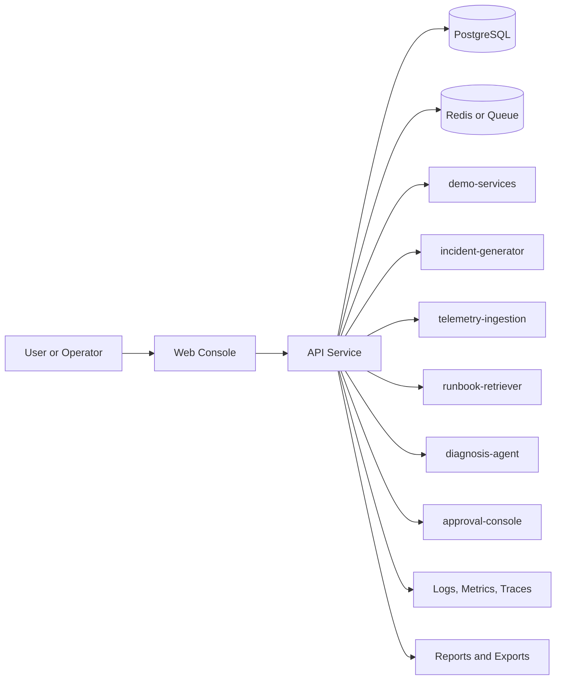
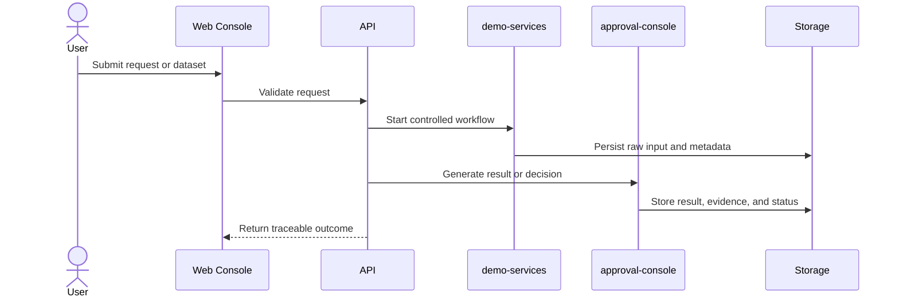
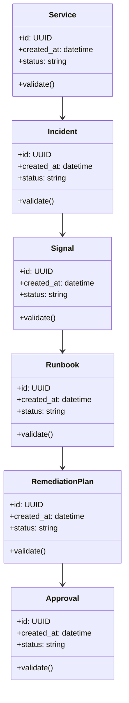

# Architecture

## System Goal

Diagnose simulated production incidents and propose remediation actions that require explicit human approval.

## Context Diagram

## Main Workflow

## Domain Model

## Component Responsibilities

- `demo-services`: owns one bounded responsibility in the workflow.
- `incident-generator`: owns one bounded responsibility in the workflow.
- `telemetry-ingestion`: owns one bounded responsibility in the workflow.
- `runbook-retriever`: owns one bounded responsibility in the workflow.
- `diagnosis-agent`: owns one bounded responsibility in the workflow.
- `approval-console`: owns one bounded responsibility in the workflow.

## Data and Control Boundaries

- Raw inputs are preserved before transformation.
- Validated records or decisions are separated from quarantined failures.
- Human approval or policy checks are explicit where automation can affect users, infrastructure, or security.
- Observability data is treated as a first-class output: logs, metrics, traces, decisions, and errors.

## Deployment Shape

- Local: Docker Compose with the FastAPI lifecycle API and functional React operator console.
- CI: lint, unit tests, integration smoke test, dependency scan.
- Demo: seeded data plus deterministic walkthrough from `docs/demo-script.md`.

## Tradeoffs and Failure Modes

- Local adapters are explicit and credential-free; durable database and authenticated cluster adapters are deployment extensions.
- External API dependencies must be optional in demos.
- AI-assisted outputs require evidence, validation, or human approval.
- Data and network claims must clearly identify synthetic, simulated, or public inputs.
