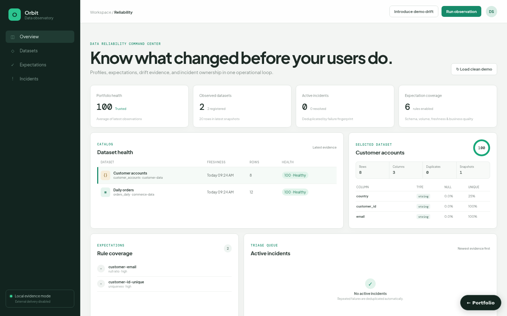

# Orbit — Autonomous Data Quality Observatory

A complete local DataOps workflow for real bounded source reads, immutable profiling evidence, versioned expectations, baseline drift detection, explainable health, and deduplicated incident operations.



**Status:** Full viable local product. CSV, JSON, and inline records are read and profiled genuinely. PostgreSQL and S3 are explicit integration boundaries: without a deployment adapter they return an actionable unavailable response and never fabricate rows.

## Product workflow

1. Register a source and preview its bounded data.
2. Add technical or business expectations.
3. Observe the source to store a profile and establish/reuse a baseline.
4. Inspect schema, type, volume, distribution, freshness, and rule evidence.
5. Triage deduplicated incidents, assign/comment/acknowledge/resolve them, or generate Jira-compatible JSON.
6. Review dataset health and historical profiles in the web console or API.

The console covers the catalog, the selected dataset's latest profile, rule results, drift signals, and resolving incidents. Source registration, previews, rule authoring, assignment, comments, acknowledgement, and Jira-compatible export are API routes.

The **Load clean demo** action creates two datasets of synthetic sample records (read and profiled by the same code path as any source), six rules, healthy baselines, and observations. **Introduce demo drift** changes the actual orders records, reruns observation, and produces reproducible schema, volume, freshness, and rule failures.

## Run

```bash
docker compose up
```

- Console: <http://localhost:5173>
- OpenAPI: <http://localhost:8015/docs>
- Readiness: <http://localhost:8015/ready>

Compose stores sources, profiles, rules, reports, and incidents in a SQLite database on the `state-data` volume (see [Persistence](#persistence)). Without Docker:

```bash
python3 -m venv .venv
. .venv/bin/activate
pip install -r requirements-dev.txt
PYTHONPATH=src DATA_QUALITY_STATE_FILE=./.local/state.json \
  uvicorn autonomous_data_quality_observatory.api.app:app --port 8015 --reload
```

Then run `npm install && npm run dev` from `frontend/`.

## Supported evidence

Profiles retain:

- row and duplicate counts;
- union schema and inferred types;
- null count/ratio and unique count/ratio;
- numeric min, max, mean, and standard deviation;
- bounded categorical top values;
- content hash, source freshness, timestamp, sampling flag, and baseline status.

Rules support `schema`, `volume`, `null_check`, `null_ratio`, `uniqueness`, `range`, `freshness`, and `business_expression`. Business expressions use an AST allow-list limited to names, constants, boolean operators, and comparisons—calls, attributes, subscripts, and imports are rejected.

Drift compares the selected baseline for schema, type, row volume, and normalized numeric mean shifts. Every signal includes its score, threshold, and explanation.

## Connector safety

- Inline and JSON `records` are bounded to 10,000 rows.
- CSV/JSON `content` and files are bounded to 5 MiB.
- File paths must stay under `DATA_QUALITY_ALLOWED_DATA_DIR` after resolution.
- API connectors require `http(s)` and an exact hostname in `DATA_QUALITY_API_ALLOW_HOSTS`, use a five-second timeout, and bound response bytes.
- Secret-shaped config keys are redacted in responses.
- PostgreSQL/S3 need deployment-specific read-only clients and secret resolution; unavailable adapters fail closed.

## API highlights

| Method | Route | Purpose |
|---|---|---|
| `POST/GET/PUT` | `/api/sources` | Register, list, or replace source configuration |
| `POST` | `/api/sources/{id}/preview` | Test and preview a bounded read |
| `POST` | `/api/rules` | Create or version an expectation |
| `POST` | `/api/observe/{id}` | Profile, evaluate, detect drift, score, and incident |
| `GET` | `/api/sources/{id}/profiles` | Query immutable history |
| `PUT` | `/api/sources/{id}/baseline/{profile_id}` | Promote a reviewed baseline |
| `GET/PATCH` | `/api/issues` and `/api/issues/{id}` | Triage incident lifecycle |
| `POST` | `/api/issues/{id}/export` | Generate honest Jira-compatible evidence JSON |

## Verify

```bash
PYTHONPATH=src pytest -q
cd frontend && npm run build && npm run lint
docker compose config --quiet
```

Tests cover real CSV parsing, statistical profiles, all rule families, safe expression rejection, drift, empty data, baseline-to-incident journeys, issue deduplication/resolution/export, secret redaction, and unavailable connectors.

## Boundaries and next deployment steps

- The JSON repository is durable for a single local API process. Multi-replica use should implement the repository boundary with PostgreSQL and transactional incident fingerprints.
- Profile inference is intentionally deterministic and dependency-light. Large production datasets need pushdown/sampling adapters and a sampling confidence policy.
- Jira-compatible export does not claim delivery. Add an approved webhook adapter with authentication, retries, idempotency keys, and delivery audit before enabling it.
- Add SSO/RBAC, TLS, scheduled workers, connector secrets, backup/retention policy, and metrics collection before external exposure.

See [architecture](docs/architecture.md), [algorithm notes](docs/algorithms-and-data-structures.md), and [testing strategy](docs/testing-strategy.md).

## Persistence

State is in memory by default, so the project runs with no setup. Set `DATA_QUALITY_DATABASE_URL` to persist it:

```bash
DATA_QUALITY_DATABASE_URL=sqlite:///./.local/state.sqlite3                          # single file
DATA_QUALITY_DATABASE_URL=postgresql+psycopg2://<user>:<password>@<host>:5432/<db>   # PostgreSQL
```

On startup the service restores its collections (`sources`, `profiles`, `rules`, `issues`, `reports`); after every successful write request it saves the documents that changed, and deletes removed ones, in one transaction. `docker compose up` uses SQLite on a named volume. For PostgreSQL, copy `.env.example` to `.env`, choose a `POSTGRES_PASSWORD`, and run `docker compose -f docker-compose.yml -f compose.postgres.yml up`; Compose refuses to start without the password, and no credential is committed. `tests/integration/test_persistence_restart.py` proves that state written by one process is served by a fresh process; set `PERSISTENCE_TEST_DATABASE_URL` to run it against PostgreSQL.

The older JSON-file option still works for single-process use; prefer the database URL, and do not enable both.
