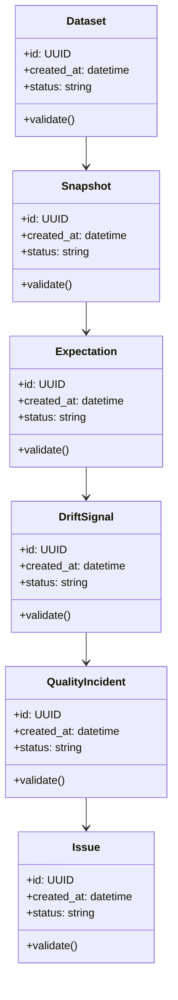

# Algorithms and Data Structures

## Implemented Algorithms

| # | Algorithm | Delivery Evidence |
|---|---|---|
| 1 | bounded statistical column profiling | Implemented for nulls, uniqueness, ranges, means, deviations, and categories |
| 2 | schema/type/baseline drift detection | Implemented with signal scores and thresholds |
| 3 | normalized numeric mean and volume drift | Implemented with deterministic baseline comparison tests |
| 4 | seven-family expectation engine | Implemented for schema, volume, null, uniqueness, range, freshness, and safe expressions |
| 5 | active-incident fingerprint deduplication | Implemented with occurrence counts, timeline, assignment, and resolution tests |

## Core Data Structures

| Structure | Purpose | Notes |
|---|---|---|
| `DatasetProfile` | Core data structure for Autonomous Data Quality Observatory | Document invariants and serialization format |
| `ExpectationSuite` | Core data structure for Autonomous Data Quality Observatory | Document invariants and serialization format |
| `DriftVector` | Core data structure for Autonomous Data Quality Observatory | Document invariants and serialization format |
| `QualityIncident` | Core data structure for Autonomous Data Quality Observatory | Document invariants and serialization format |
| `IssuePayload` | Core data structure for Autonomous Data Quality Observatory | Document invariants and serialization format |

## UML-Style Domain View

## Complexity Targets

- Prefer linear or near-linear processing for ingestion and validation steps.
- Use indexed lookup structures for repeated retrieval, policy, and ownership checks.
- Keep expensive AI/model calls outside tight loops.
- Cache deterministic intermediate results with versioned keys.

## Required Tests

- Happy-path unit tests for each algorithm.
- Boundary tests for empty input, malformed input, duplicate input, and large input.
- Regression tests for known failure modes.
- Deterministic seed tests for synthetic data, simulation, or model evaluation.
- Contract tests for serialized data structures.

## Implementation Notes

The delivered workflow reads real bounded data, stores immutable profiles, evaluates rules, compares a selected baseline, scores health, and manages incident lifecycle evidence.
