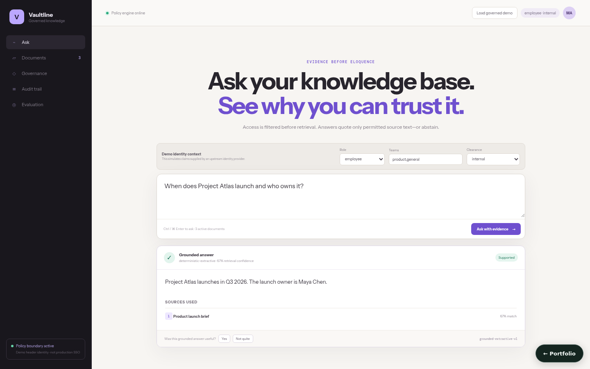

# Compliance-Aware RAG Knowledge Base

A governed, locally runnable knowledge product with **pre-retrieval access policy**, deterministic hybrid search, extractive grounded answers, exact citations, document lifecycle, retention, redaction, feedback, audit, and golden-set evaluation.



**Status:** Full viable local product. It works without an external model. The default answer engine is explicitly `deterministic-extractive`, so it can quote permitted evidence or abstain without pretending a mock is an LLM.

## Core journey

1. An administrator ingests PDF, DOCX, Markdown, HTML, or UTF-8 text and classifies owner, team, roles, allowed teams, sensitivity, tags, and retention.
2. The service parses, checksums, optionally redacts, chunks, embeds, indexes, and audits the document.
3. A user asks with demo identity claims for role, teams, and clearance.
4. Status, expiry, clearance, role, and team policy run **before chunks can be ranked**.
5. Hybrid lexical/vector retrieval applies a minimum relevance threshold.
6. The answer quotes exact permitted sentences (a contiguous span per chunk) with source title, chunk, character offsets, and lexical/vector/final scores—or clearly abstains.
7. Feedback, lifecycle changes, retention, redaction, and evaluation remain reconstructable in the audit trail.

The React console implements Ask, Documents, Governance, Audit, and Evaluation views with responsive states and a transparent demo identity switcher.

## Run

```bash
docker compose up
```

- Console: <http://localhost:5173>
- OpenAPI: <http://localhost:8016/docs>
- Readiness: <http://localhost:8016/ready>

Compose persists documents, chunks, audit events, redaction rules, feedback, evaluation runs, and answers in a SQLite database on the `state-data` volume (see [Persistence](#persistence)).

Without Docker:

```bash
python3 -m venv .venv
. .venv/bin/activate
pip install -r requirements-dev.txt
PYTHONPATH=src RAG_STATE_DIR=./.local/rag-state \
  uvicorn compliance_aware_rag_knowledge_base.api.app:app --port 8016 --reload
```

Then `npm install && npm run dev` from `frontend/`.

## Demo identity boundary

This local product accepts these headers:

```text
X-User-ID
X-User-Role: admin | employee | contractor
X-User-Teams: comma,separated
X-User-Clearance: public | internal | confidential | restricted
```

They are deliberately labeled **demo identity context**. They demonstrate server-side policy behavior, but they are not authentication. A production deployment must place verified SSO/OIDC claims at the boundary and strip client-supplied identity headers. Admin routes enforce `admin` even in demo mode.

## Retrieval and grounding

- Tokenization is deterministic and punctuation-aware.
- Local semantic vectors use signed feature hashing into 64 dimensions; cosine score is real and reproducible, with no embedding service required.
- The lexical component measures unique query-term coverage with bounded term frequency, ignoring common stopwords (so "and"/"who" alone never make a chunk relevant) and applying a small suffix stemmer (so "owns" matches "owner").
- Final rank is `55% lexical + 45% vector`, with an explicit relevance threshold.
- Policy-eligible chunks alone enter ranking. Responses do not reveal inaccessible document titles or counts.
- Extractive answers select the best matching sentence from each of up to three chunks, extended to adjacent sentences when they cover further question terms (for example "when … and who owns it"); each quote remains one verbatim span of the chunk. Citation validation checks that every quote exists in the retrieved chunk and document IDs agree.
- Unsupported or irrelevant questions return no citations and an explicit abstention.

## Governance behavior

- Soft delete/restore and permission/classification updates take immediate effect; updates re-index chunks and increment document version.
- Retention preview/enforcement evaluates explicit UTC expiry and records the affected IDs.
- Regex redaction rules are compiled, bounded, versioned, previewable, enabled/disabled, and can apply at ingestion/audit. A guard rejects a common nested-repetition risk.
- File upload is limited to 5 MiB, filenames are normalized, active HTML elements are removed, empty/unsupported/encrypted/broken documents fail explicitly, and parser errors never become fake document content.
- Secret or PII redaction policy remains deployment-specific; add organization-reviewed patterns before sensitive use.

## Evaluation evidence

Persisted golden runs report:

- expected-keyword retrieval hit rate;
- citation validity;
- abstention accuracy;
- permission leak count;
- average case latency;
- per-case result and overall pass/fail.

The seeded three-case evaluation covers an authorized product query, a protected security query that must abstain for a contractor, and authorized contractor onboarding evidence.

## API highlights

| Method | Route | Purpose |
|---|---|---|
| `POST` | `/api/ingest` | Parse, classify, index, and audit a file |
| `POST` | `/api/query` | Policy-filter then answer or abstain |
| `POST` | `/api/answers/{id}/feedback` | Link rating/reason to an answer |
| `GET/PATCH/DELETE` | `/api/admin/documents` | List metadata, update, or soft-delete |
| `POST` | `/api/admin/documents/{id}/restore` | Restore a soft-deleted version |
| `GET/POST` | `/api/admin/redactions` | List or create versioned rules |
| `GET/POST` | `/api/admin/retention/*` | Preview or enforce expiry |
| `GET` | `/api/admin/audit` | Query decision and evidence history |
| `GET/POST` | `/api/admin/evaluations` | Query or run golden sets |

## Verify

```bash
PYTHONPATH=src pytest -q
cd frontend && npm run build && npm run lint
docker compose config --quiet
```

Tests cover parsing, chunk offsets, embeddings/ranking components, policy denial reasons, exact citation checks, redaction, authorized/unauthorized queries, delete/restore, feedback, evaluation leakage, upload validation, and admin enforcement.

## Deployment boundaries

- JSON repositories are durable for one local process. Multi-replica deployments should implement the same repository boundaries with PostgreSQL/pgvector, transactions, migrations, backups, retention jobs, and immutable audit controls.
- Add OIDC/SSO, TLS, malware scanning, content-disarm policy, rate limits, antivirus, encryption/key management, and centralized metrics before sensitive or external deployment.
- Optional LLM synthesis must receive only already-permitted context, preserve exact citations, remain injection-isolated from tools, and pass the same grounding evaluation.

See [architecture](docs/architecture.md), [algorithm notes](docs/algorithms-and-data-structures.md), and [testing strategy](docs/testing-strategy.md).

## Persistence

State is in memory by default, so the project runs with no setup. Set `COMPLIANCE_AWARE_RAG_KNOWLEDGE_BASE_DATABASE_URL` to persist it:

```bash
COMPLIANCE_AWARE_RAG_KNOWLEDGE_BASE_DATABASE_URL=sqlite:///./.local/state.sqlite3                          # single file
COMPLIANCE_AWARE_RAG_KNOWLEDGE_BASE_DATABASE_URL=postgresql+psycopg2://<user>:<password>@<host>:5432/<db>   # PostgreSQL
```

On startup the service restores its collections (`documents`, `chunks`, `audit`, `redaction_rules`, `feedback`, `evaluations`, `answers`); after every successful write request it saves the documents that changed, and deletes removed ones, in one transaction. `docker compose up` uses SQLite on a named volume. For PostgreSQL, copy `.env.example` to `.env`, choose a `POSTGRES_PASSWORD`, and run `docker compose -f docker-compose.yml -f compose.postgres.yml up`; Compose refuses to start without the password, and no credential is committed. `tests/integration/test_persistence_restart.py` proves that state written by one process is served by a fresh process; set `PERSISTENCE_TEST_DATABASE_URL` to run it against PostgreSQL.

The older JSON-file option still works for single-process use; prefer the database URL, and do not enable both.
