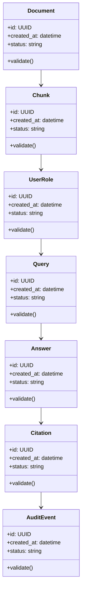

# Algorithms and Data Structures

## Implemented Algorithms

| # | Algorithm | Delivery Evidence |
|---|---|---|
| 1 | lexical plus signed-feature-hash vector retrieval | Implemented with separate component scores and relevance threshold |
| 2 | pre-retrieval status/expiry/clearance/role/team policy | Implemented with denial-reason and non-leakage tests |
| 3 | exact quote/chunk/document citation validation | Implemented with character offsets and tampering tests |
| 4 | extractive grounding and safe abstention | Implemented with unsupported/unauthorized query tests |
| 5 | golden-question quality and permission evaluation | Implemented with hit, citation, abstention, leakage, and latency metrics |

## Core Data Structures

| Structure | Purpose | Notes |
|---|---|---|
| `DocumentAclIndex` | Core data structure for Compliance-Aware RAG Knowledge Base | Document invariants and serialization format |
| `ChunkVectorStore` | Core data structure for Compliance-Aware RAG Knowledge Base | Document invariants and serialization format |
| `RetrievalResultHeap` | Core data structure for Compliance-Aware RAG Knowledge Base | Document invariants and serialization format |
| `CitationMap` | Core data structure for Compliance-Aware RAG Knowledge Base | Document invariants and serialization format |
| `AuditTrail` | Core data structure for Compliance-Aware RAG Knowledge Base | Document invariants and serialization format |

## UML-Style Domain View

## Complexity Targets

- Prefer linear or near-linear processing for ingestion and validation steps.
- Use indexed lookup structures for repeated retrieval, policy, and ownership checks.
- Keep expensive AI/model calls outside tight loops.
- Cache deterministic intermediate results with versioned keys.

## Required Tests

- Happy-path unit tests for each algorithm.
- Boundary tests for empty input, malformed input, duplicate input, and large input.
- Regression tests for known failure modes.
- Deterministic seed tests for synthetic data, simulation, or model evaluation.
- Contract tests for serialized data structures.

## Implementation Notes

The delivered workflow parses and classifies documents, filters before retrieval, returns exact evidence or abstains, and persists lifecycle, redaction, feedback, audit, and evaluation records.
