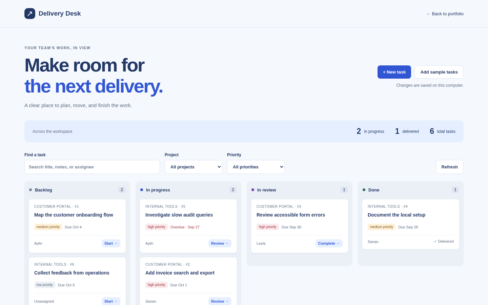

# Delivery Desk

A local delivery board for planning work across projects. Create and edit tasks, filter by project and priority, move work through four stages, track due dates, and inspect a persistent change history. Optimistic version checks prevent one browser tab from silently overwriting another.



## Run locally

From this directory, with Python 3.10+:

```sh
python3 -m pip install -r requirements.txt
PYTHONPATH=src python3 -m uvicorn delivery_desk.api.app:app --host 127.0.0.1 --port 8021
```

Open http://127.0.0.1:8021. Use **Add sample tasks** for an optional, idempotent sample workspace. It never clears existing tasks. The portfolio hub also serves this frontend at `/demos/delivery-desk/` and its API at `/api/projects/delivery-desk/api`.

Data is stored in `.local/data/delivery.sqlite3`. Set `DELIVERY_DESK_DB` to a different SQLite path before starting. Restarting the service preserves data. `create_app(db_path=...)` supports isolated test instances.

```sh
PYTHONPATH=src python3 -m pytest tests -q
```

### Docker Compose

```sh
docker compose up
```

The API runs on http://127.0.0.1:8021 and an nginx container serves the console on http://127.0.0.1:5173, forwarding `/api` to the API. Data persists in a named volume.

### Tests

`tests/unit` covers validation contracts and `tests/integration` covers HTTP workflows, concurrency, and persistence. Browser workflows for both business apps run with `npm run test:business` from the portfolio root.

See [architecture](docs/architecture.md), [algorithms](docs/algorithms-and-data-structures.md), [testing strategy](docs/testing-strategy.md), [demo script](docs/demo-script.md), and the [backlog](BACKLOG.md).

## API and scope

- `GET /health`: database reachability.
- `GET /api/tasks`: tasks, available projects, and workspace counts; accepts `q`, `project`, `status`, `priority`.
- `POST /api/tasks`: create a task.
- `GET /api/tasks/{id}`: task and chronological change records (newest first).
- `PATCH /api/tasks/{id}`: edit fields with the last known `version`; returns 409 for stale edits.
- `POST /api/demo/seed`: add sample tasks once.

This is a single-user local application, with no authentication, external notifications, or cloud sync. Assignees and project names are plain labels. The four workflow stages allow moving work in either direction. Keep the server bound to localhost; do not expose it as a multi-user service without authentication and authorization. The frontend uses browser-native controls and local assets only.
