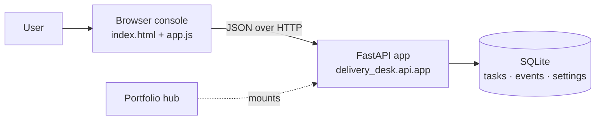
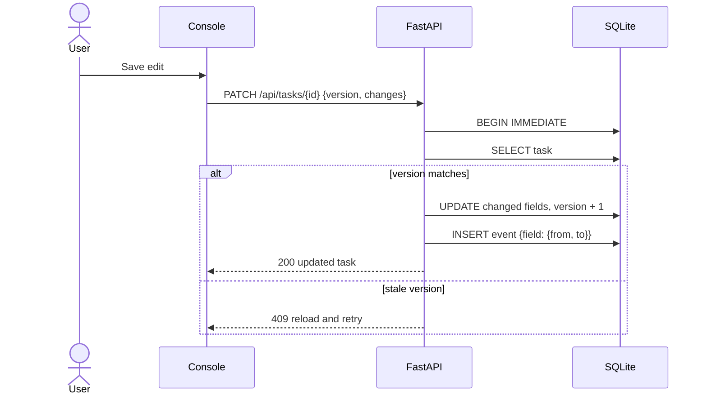

# Architecture

## System goal

Give one person a dependable local board for planning delivery work, where an edit is never silently lost and every change can be traced.

## Context

The console is plain HTML, CSS, and a browser module; there is no build step. It detects whether it runs standalone (`/api`) or inside the portfolio hub (`/api/projects/delivery-desk/api`).

## Edit with optimistic concurrency

## Data model

| Table | Purpose |
|---|---|
| `tasks` | Current task state with `CHECK` constraints on stage and priority, and a `version` counter |
| `events` | Append-only history: `created` payloads and per-field `{from, to}` changes |
| `settings` | Flags such as `demo_seeded` that keep the sample workspace idempotent |

## Boundaries

Single-user, localhost only. No authentication, notifications, or cloud sync. See [ADR 0001](adr/0001-core-architecture.md).
