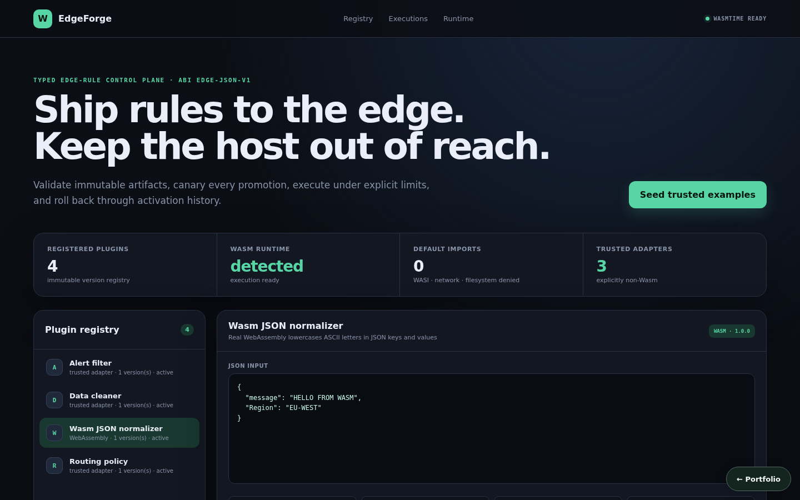
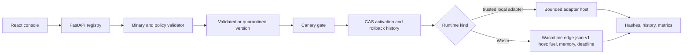

# EdgeForge — Edge Wasm Plugin Runtime

**Project 12 · runnable full product · explicit runtime provenance**



EdgeForge provides a policy-controlled plugin registry: immutable versions, strict base64 and Wasm-v1 structural validation, import/export checks, quarantining, canary gates, compare-and-set activation, activation-history rollback, bounded JSON execution, hashes, history, percentiles, and labeled benchmarks.

Uploaded Wasm artifacts execute in Wasmtime through the `edge-json-v1` ABI (exported `memory`, `alloc`, and `run`). Every execution gets a fresh instance with fuel, memory, input/output, and deadline limits, and no host or WASI imports. The seeded `json-normalizer` plugin is a real Wasm module compiled from inspectable WAT (`GET /api/runtime/examples`). The three other examples are deliberately identified as **trusted Python adapters**, not Wasm; a Wasm artifact is never string-matched or silently routed through an adapter. If Wasmtime is not installed, Wasm execution fails closed with `runtime_unavailable`.

## Product workflow

1. Seed the real Wasm `json-normalizer` plus data-cleaning, alert-filtering, and routing-policy adapters, or register a plugin.
2. Upload a local-adapter manifest or strict-base64 Wasm artifact and inspect its hash and validation findings.
3. Run a selected version as a canary; only a successful validated canary may activate.
4. Execute the active version under input/output, timeout, memory, and fuel policy.
5. Activate a second version with expected-active compare-and-set, then roll back through actual activation history.
6. Inspect executions, hashes, runtime provenance, error rates, p50/p95/p99, and explicitly labeled benchmarks.

The console covers seeding, the plugin registry (each entry says whether it runs as WebAssembly or as a trusted adapter), execution of the active version with its runtime provenance and input hash, and per-version recorded-run metrics (count, error rate, p50/p95 latency). It opens on the Wasm `json-normalizer` when Wasmtime is available. Upload, canary, activation, rollback, and benchmarks are exercised through the API routes below.

## Run locally

```bash
python3 -m venv .venv
. .venv/bin/activate
pip install -r requirements.txt -r requirements-dev.txt
PYTHONPATH=src uvicorn edge_wasm_plugin_runtime.api.app:app --port 8013
```

```bash
cd frontend
npm install
npm run dev
```

Open `http://localhost:5173`, or run `docker compose up`. API docs are at `http://localhost:8013/docs`.

## Key API routes

- `POST/GET /api/plugins...` — registry and immutable versions
- `POST /api/plugins/{id}/versions/{tag}/canary`
- `POST /api/plugins/{id}/activate/{tag}` and `/rollback`
- `POST /api/execute`
- `GET /api/plugins/{id}/executions`
- `GET /api/plugins/{id}/versions/{tag}/metrics`
- `POST /api/plugins/{id}/versions/{tag}/benchmark`
- `GET /api/runtime/capabilities`, `GET /api/runtime/examples`, and `POST /api/demo/seed`

## Verification

```bash
PYTHONPATH=src pytest -q
cd frontend && npm run build
```

Tests cover real Wasmtime round-trips, fuel exhaustion, deadline interruption, memory-growth limits, denied host imports, start-function fuel accounting, invalid guest JSON, trusted adapter contracts, output limits, strict base64, Wasm header/export policy, quarantine, runtime fail-closed behavior, canary gating, activation conflict, execution hashes, history, metrics, benchmark labels, and idempotent rollback retry.

## Security boundary and runtime status

Default imports are empty and WASI is denied. Artifacts are capped before allocation; input/output are canonical JSON with byte limits; inputs are represented in records by SHA-256. The pure-Python validator parses the Wasm header plus import/export sections; Wasmtime then performs full engine validation before a version can be accepted. Execution is interrupted by whichever comes first: fuel exhaustion or the wall-clock deadline (which also covers instantiation and any start function). Guest output must be a bounded, finite JSON object. The plugin registry and execution history are in memory by default and persist when a database URL is configured (see [Persistence](#persistence)).



See [`docs/`](docs/) for supporting architecture and operational material.

## Persistence

State is in memory by default, so the project runs with no setup. Set `EDGE_WASM_DATABASE_URL` to persist it:

```bash
EDGE_WASM_DATABASE_URL=sqlite:///./.local/state.sqlite3                          # single file
EDGE_WASM_DATABASE_URL=postgresql+psycopg2://<user>:<password>@<host>:5432/<db>   # PostgreSQL
```

On startup the service restores its collections (`plugins`, `executions`); after every successful write request it saves the documents that changed, and deletes removed ones, in one transaction. `docker compose up` uses SQLite on a named volume. For PostgreSQL, copy `.env.example` to `.env`, choose a `POSTGRES_PASSWORD`, and run `docker compose -f docker-compose.yml -f compose.postgres.yml up`; Compose refuses to start without the password, and no credential is committed. `tests/integration/test_persistence_restart.py` proves that state written by one process is served by a fresh process; set `PERSISTENCE_TEST_DATABASE_URL` to run it against PostgreSQL.
