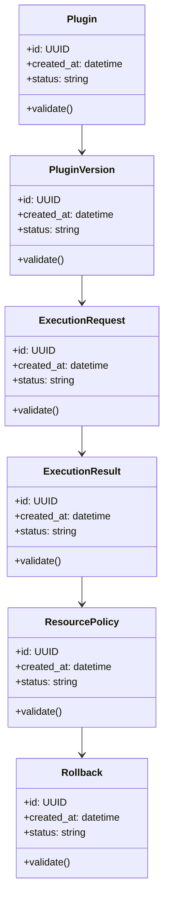

# Algorithms and Data Structures

## Algorithm Roadmap

| # | Algorithm | Implementation Requirement |
|---|---|---|
| 1 | Wasm module validation | Implemented for header/import/export policy |
| 2 | resource-limit policy | Implemented for bounded local adapters; Wasm host fails closed |
| 3 | immutable version selection | Implemented with duplicate tag/hash rejection |
| 4 | rollback selection | Implemented from activation history |
| 5 | latency benchmarking | Implemented with explicit runtime-kind labels |

## Core Data Structures

| Structure | Purpose | Notes |
|---|---|---|
| `PluginManifest` | Core data structure for Edge Wasm Plugin Runtime for Data and Network Rules | Document invariants and serialization format |
| `VersionedPluginStore` | Core data structure for Edge Wasm Plugin Runtime for Data and Network Rules | Document invariants and serialization format |
| `ExecutionSandbox` | Core data structure for Edge Wasm Plugin Runtime for Data and Network Rules | Document invariants and serialization format |
| `ResourceBudget` | Core data structure for Edge Wasm Plugin Runtime for Data and Network Rules | Document invariants and serialization format |
| `BenchmarkSeries` | Core data structure for Edge Wasm Plugin Runtime for Data and Network Rules | Document invariants and serialization format |

## UML-Style Domain View

## Complexity Targets

- Prefer linear or near-linear processing for ingestion and validation steps.
- Use indexed lookup structures for repeated retrieval, policy, and ownership checks.
- Keep expensive AI/model calls outside tight loops.
- Cache deterministic intermediate results with versioned keys.

## Required Tests

- Happy-path unit tests for each algorithm.
- Boundary tests for empty input, malformed input, duplicate input, and large input.
- Regression tests for known failure modes.
- Deterministic seed tests for synthetic data, simulation, or model evaluation.
- Contract tests for serialized data structures.

## Implementation Notes

The first code milestone should implement the smallest useful vertical slice: parse or ingest input, run one core algorithm, persist the result, and expose it through a CLI or API endpoint.
