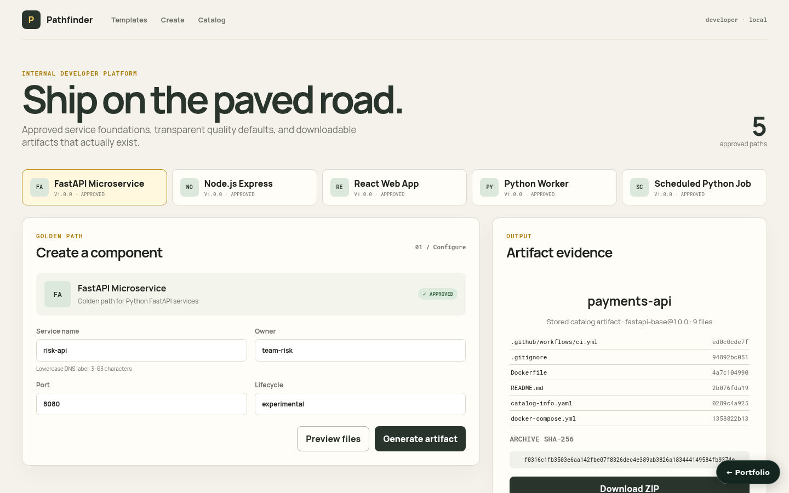

# Internal Developer Portal with Golden Paths

**Project 07 · Locally runnable product**



Pathfinder provides five governed golden paths and produces real deterministic ZIP artifacts. The API validates input, renders files, calculates per-file and archive checksums, stores the archive, and only then registers the service in the catalog.

## Complete workflow

- Discover approved FastAPI, Node/Express, React, Python worker, and scheduled-job templates.
- Preview validated output paths before generation.
- Render Docker, Compose, real CI commands, tests, README, ignore rules, and ownership metadata for every path.
- Download a deterministic ZIP and inspect its checksum manifest.
- Register and browse service ownership, exact template version, lifecycle, and dependencies; query the dependency graph.
- Create draft template versions and approve them through server-enforced admin role headers.
- Use the responsive React scaffold wizard and catalog without fabricated repository links. The console opens the most recently registered service's stored artifact (per-file SHA-256 digests, archive checksum, ZIP download); selecting any catalog row shows that service's evidence.

## Run and verify

```bash
docker compose up --build
# UI: http://localhost:5173
# OpenAPI: http://localhost:8008/docs

PYTHONPATH=src pytest -q
cd frontend && npm run build
```

The integration suite downloads the generated ZIP, verifies its checksum manifest and required files, exercises catalog/graph registration, admin governance, and validation failures.

## Safety and adapter boundary

`LocalArtifactStore` is a bounded process-local adapter: it caps file count and bytes, rejects absolute/traversal/backslash paths, uses stable ZIP timestamps, and never runs generated hooks. It does not claim to create a Git repository. Durable catalog/object storage, OIDC identity, and an authenticated SCM adapter can replace the local adapters while preserving the scaffold contract.

## Key files

- `algorithms/template_engine.py` — five runnable generators
- `algorithms/quality_defaults.py` — Docker, CI, Compose, ownership defaults
- `adapters/artifacts.py` — deterministic safe ZIP and manifests
- `services/scaffolder.py` — validation and atomic registration
- `frontend/src/App.tsx` — template selection, preview, artifact, and catalog UI

## Persistence

State is in memory by default, so the project runs with no setup. Set `INTERNAL_DEVELOPER_PORTAL_DATABASE_URL` to persist it:

```bash
INTERNAL_DEVELOPER_PORTAL_DATABASE_URL=sqlite:///./.local/state.sqlite3                          # single file
INTERNAL_DEVELOPER_PORTAL_DATABASE_URL=postgresql+psycopg2://<user>:<password>@<host>:5432/<db>   # PostgreSQL
```

On startup the service restores its collections (`services`, `templates`, `manifests`, `archives`); after every successful write request it saves the documents that changed, and deletes removed ones, in one transaction. `docker compose up` uses SQLite on a named volume. For PostgreSQL, copy `.env.example` to `.env`, choose a `POSTGRES_PASSWORD`, and run `docker compose -f docker-compose.yml -f compose.postgres.yml up`; Compose refuses to start without the password, and no credential is committed. `tests/integration/test_persistence_restart.py` proves that state written by one process is served by a fresh process; set `PERSISTENCE_TEST_DATABASE_URL` to run it against PostgreSQL.
