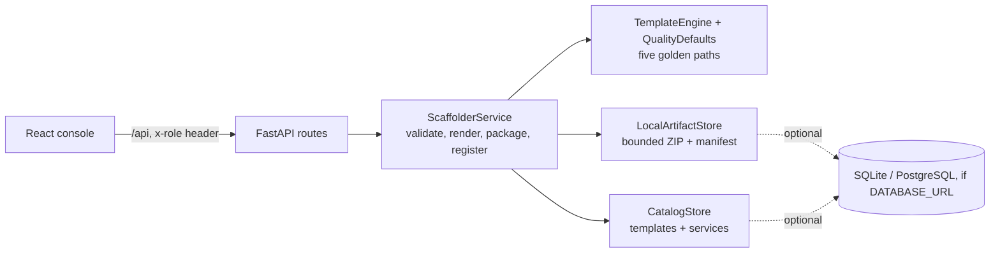

# Architecture

Pathfinder is one FastAPI service plus a React console. It renders approved templates into files, packages them as a deterministic ZIP, and registers the service in a catalog only after the archive is stored. It does not create Git repositories or run generated code.

## Components

| Module | Responsibility |
|---|---|
| `adapters/repositories.py` | Catalog of five approved templates (FastAPI, Node/Express, React, Python worker, scheduled job) and registered services; service names are unique. |
| `algorithms/template_engine.py` | Renders each golden path into a file map (app code, tests, Dockerfile, Compose file where relevant, README, CI workflow, `.gitignore`, `catalog-info.yaml`). |
| `algorithms/quality_defaults.py` | Shared Dockerfile, Compose, CI, and ownership metadata generators. |
| `adapters/artifacts.py` | Caps file count (100) and size (2 MB), rejects absolute, traversal, and backslash paths, writes files in sorted order with a fixed timestamp, and records per-file and archive SHA-256 digests. |
| `services/scaffolder.py` | Validates DNS-safe names, port range 1024–65535, owner, registered dependencies, and template approval; stores the archive, then registers the service, removing the archive if registration fails. |
| `api/routes.py` | Templates (admin-only creation and approval via the `x-role` header), preview, scaffold, manifest, download, catalog, dependency graph. |

## Main workflow

1. `GET /api/templates` lists templates; only `approved` ones can be used.
2. `POST /api/scaffold/preview` returns the validated file list without storing anything.
3. `POST /api/scaffold` stores the ZIP and manifest, then registers the catalog record.
4. `GET /api/artifacts/{id}/manifest` and `GET /api/download/{id}` return the stored evidence; the console shows it for the newest service on load and for any catalog row that is selected.

## Boundaries

- Roles come from a request header for local demonstration; a real deployment needs an identity provider.
- Artifacts live in process memory unless a database URL is configured, in which case archives are stored in the database.
