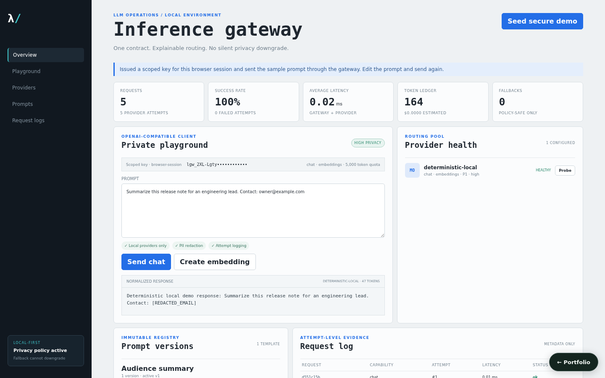

# Local AI Inference Gateway and LLMOps Console

An OpenAI-compatible, local-first gateway with real bounded HTTP adapters for Ollama and OpenAI-compatible/vLLM servers, an explicitly labeled deterministic offline provider, privacy-aware fallback, hashed gateway keys, quotas, strict prompt versions, embeddings, and attempt-level operational evidence.



## What works

- Root `POST /v1/chat/completions`, `POST /v1/embeddings`, and `GET /v1/models` contracts; `/api/v1/*` compatibility routes remain available.
- Real Ollama `/api/chat` and `/api/embeddings` calls and generic OpenAI-compatible `/chat/completions`, `/embeddings`, and `/models` calls with configured deadlines and redirects disabled.
- Capability/privacy/priority/cost routing. Every failed and fallback attempt is recorded; high-privacy requests can never fall back to a lower privacy provider.
- HMAC-hashed gateway API keys, one-time plaintext reveal, scopes, per-minute request limits, token quotas, PII redaction, and metadata-only request logs.
- Immutable prompt versions, derived variables, strict render, explicit activation, provider probes, usage metrics, and a responsive operations/playground console.

## Run locally

```bash
python3 -m venv .venv
. .venv/bin/activate
pip install -r requirements.txt -r requirements-dev.txt
PYTHONPATH=src uvicorn local_ai_inference_gateway_llmops_console.api.app:app --reload --port 8004
```

Run `npm install && npm run dev` in `frontend/`, or use `docker compose up`, and open `http://localhost:5173`. **Seed secure demo** creates a deterministic in-process provider, scoped 10k-token key, and strict summarizer template. The key is kept in browser memory and shown only by the create response. When the console opens against a gateway that already has an active provider (for example the portfolio hub's demo data), it issues a small scoped key for that browser session through `POST /api/admin/keys` (chat and embeddings, 30 requests/minute, 5,000 tokens) and sends the sample prompt, so the playground shows a real routed, redacted response. The key is kept in that tab's `sessionStorage` and reused on reload; a new one is issued only if the gateway no longer accepts it. Each page load's sample request is counted in the metrics and logs like any other.

## Provider configuration

- `type: ollama`: set `api_base` (for example `http://localhost:11434`) and `model_name`.
- `type: vllm` or `openai`: set an OpenAI-compatible base ending in `/v1`, `model_name`, and optional write-only `api_key`.
- `type: mock`: reserved for the deterministic in-process offline/test provider; responses are labeled “Deterministic local demo”. It never simulates a remote call.

Provider credentials are excluded from every API response. `GATEWAY_KEY_PEPPER` must be supplied from secret storage outside local development.

## Main API workflow

1. `POST /api/demo/seed` or admin provider/key/template endpoints configure the gateway.
2. A Bearer gateway key authenticates chat/embedding scope and consumes rate/quota.
3. Routing filters capability, active status, and privacy before priority/cost selection.
4. The adapter calls the real endpoint; transient/unavailable providers fall through only to an eligible provider.
5. `GET /api/admin/logs` shows request ID, attempt, error class, route, tokens, cost, and latency without prompts or secrets.
6. `GET /api/admin/metrics` aggregates logical requests and provider attempts separately.

Non-streaming chat is supported. `stream: true` returns an explicit 400 rather than pretending to stream.

## Verification

```bash
PYTHONPATH=src python3 -m pytest tests/unit tests/integration
cd frontend && npm run build
```

Tests cover routing/privacy, strict templates, key scope/rate/quota, redaction, deterministic chat/embedding contracts, attempt logging, and safe fallback. Real adapters should additionally be contract-tested against a local fake HTTP server in deployment CI.

## Security boundary

The default in-process store makes the project immediately evaluable; with a database URL, providers, prompt versions, keys, logs, and metrics persist (see [Persistence](#persistence)). Per-window rate counters stay in process memory, so atomic multi-instance quotas would still need a shared store such as Redis. Local admin endpoints are intentionally open for the demo and must be placed behind operator authentication in a shared deployment. Restrict provider base URLs with an egress allowlist before accepting untrusted admin input.

## Persistence

State is in memory by default, so the project runs with no setup. Set `LOCAL_AI_INFERENCE_GATEWAY_LLMOPS_CONSOLE_DATABASE_URL` to persist it:

```bash
LOCAL_AI_INFERENCE_GATEWAY_LLMOPS_CONSOLE_DATABASE_URL=sqlite:///./.local/state.sqlite3                          # single file
LOCAL_AI_INFERENCE_GATEWAY_LLMOPS_CONSOLE_DATABASE_URL=postgresql+psycopg2://<user>:<password>@<host>:5432/<db>   # PostgreSQL
```

On startup the service restores its collections (`providers`, `prompts`, `logs`, `api_keys`, `metrics`); after every successful write request it saves the documents that changed, and deletes removed ones, in one transaction. `docker compose up` uses SQLite on a named volume. For PostgreSQL, copy `.env.example` to `.env`, choose a `POSTGRES_PASSWORD`, and run `docker compose -f docker-compose.yml -f compose.postgres.yml up`; Compose refuses to start without the password, and no credential is committed. `tests/integration/test_persistence_restart.py` proves that state written by one process is served by a fresh process; set `PERSISTENCE_TEST_DATABASE_URL` to run it against PostgreSQL.

Gateway API keys are stored only as HMAC-SHA256 hashes (keyed by `GATEWAY_KEY_PEPPER`), and provider credentials are excluded from serialization, so no secret reaches the database. After a restart, re-enter provider credentials.
