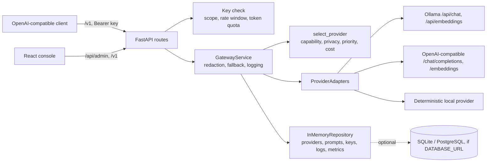

# Architecture

The gateway is one FastAPI service that exposes an OpenAI-compatible `/v1` contract and an `/api/admin` surface, plus a React operations console. Providers are reached through bounded HTTP adapters (Ollama, vLLM/OpenAI-compatible) or an in-process deterministic provider used for offline demos and tests.

## Components

| Module | Responsibility |
|---|---|
| `algorithms/routing_policy.py` | Filters active providers by capability and, for high-privacy requests, by `privacy_level == "high"`; then orders by priority and cost. |
| `services/gateway_service.py` | Optional e-mail and phone redaction before dispatch; tries providers in routing order, logs every attempt (including failures), falls back only to providers that pass the same filters, and records usage. |
| `adapters/provider_adapters.py` | HTTP calls with per-provider timeouts and redirects disabled; health probes; the deterministic provider echoes the prompt with a clear label and builds a 12-dimension byte-histogram embedding. |
| `adapters/repositories.py` | HMAC-SHA256 key hashes, scopes, per-minute windows, token quotas, metrics aggregation (logical requests vs provider attempts). |
| `algorithms/prompt_registry.py` | Variable extraction and strict rendering of the active prompt version (missing variables are an error). |

## Request flow

1. The Bearer key is checked for scope, rate window, and remaining quota. If no key has been created at all, requests are accepted without one (local bootstrap mode).
2. The prompt (or active template version) is redacted when `redact_pii` is set.
3. Providers are tried in routing order; each attempt is logged with request ID, attempt number, error class, tokens, cost, and latency. Prompts and keys are never logged.
4. The response follows the OpenAI chat or embeddings shape, plus `provider` and `fallback` fields.

## Boundaries

- Admin endpoints are unauthenticated for local use and need operator authentication before any shared deployment.
- Rate windows are per process; multiple instances would need a shared store.
- Streaming is not implemented; `stream: true` is rejected with 400.
