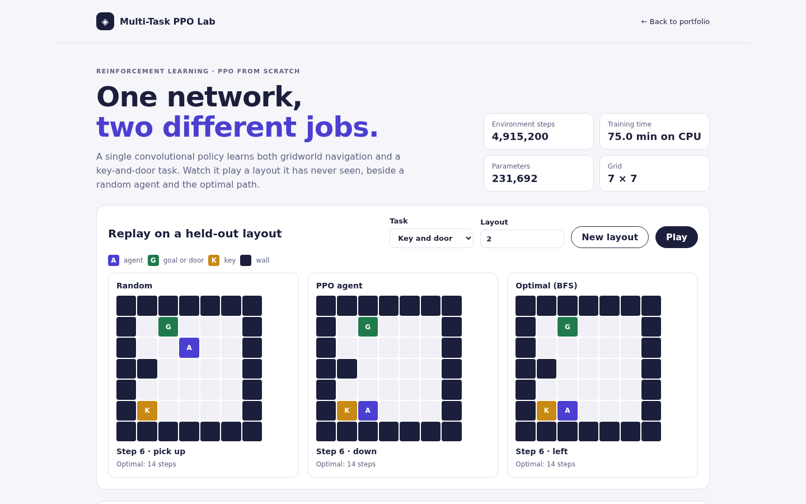

# Multi-Task PPO Lab

One neural network learns two different gridworld jobs with Proximal Policy Optimization written from scratch in PyTorch, and the console lets you watch it play layouts it has never seen, beside a random agent and the optimal path.



**Status:** full local product with a pretrained CPU policy, training CLI, API, replay console, and tests. It is a rewrite of an earlier "AGI" experiment that could not learn; see [what was fixed](#what-was-fixed).

## Tasks

| Task | Goal | Actions |
|---|---|---|
| Navigation | Reach the goal on a 7 × 7 grid with random walls | up, down, left, right |
| Key and door | Pick up the key, then open the door | the four moves, pick up, open |

Every layout is generated from a seed and checked for solvability with breadth-first search, which also provides an optimal baseline policy. Both tasks share one five-channel observation (agent, target, walls, key, carrying-key), so a single convolutional trunk serves both; each task has its own policy and value head.

<!-- results:start -->
## Results

Trained for 600 updates (4,915,200 environment steps across both tasks, 75 minutes on CPU). Evaluated on 200 held-out layouts per task and policy:

| Task | Policy | Success | Mean steps | Optimality | Mean return |
|---|---|---:|---:|---:|---:|
| Navigation | Random | 91.5% | 57.3 | 21.4% | -0.03 |
| Navigation | PPO (sampled) | 100.0% | 3.5 | 99.2% | 0.97 |
| Navigation | PPO (greedy) | 99.5% | 4.4 | 99.9% | 0.96 |
| Navigation | Optimal (BFS) | 100.0% | 3.4 | 100.0% | 0.98 |
| Key and door | Random | 20.5% | 182.2 | 7.1% | -2.28 |
| Key and door | PPO (sampled) | 99.5% | 10.1 | 98.4% | 1.10 |
| Key and door | PPO (greedy) | 98.0% | 12.6 | 99.8% | 1.04 |
| Key and door | Optimal (BFS) | 100.0% | 8.9 | 100.0% | 1.12 |

Optimality is the optimal step count divided by the steps taken, averaged over successful episodes. Greedy play follows the optimal path whenever it succeeds, but can repeat the same action forever in a state where the policy is unsure; sampling breaks those loops, which is why it solves more layouts at slightly lower optimality.
<!-- results:end -->

## Run

From the portfolio root, `npm start` and open **Multi-Task PPO Lab**. Standalone, from this directory:

```bash
python3 -m pip install -r requirements-dev.txt --extra-index-url https://download.pytorch.org/whl/cpu
PYTHONPATH=src uvicorn multitask_ppo_lab.api.app:app --port 8024
```

Open http://127.0.0.1:8024, or run `docker compose up` (API on 8024, console on 5176).

Retrain and re-evaluate (the included checkpoint took 75 minutes on a laptop CPU):

```bash
PYTHONPATH=src python3 -m multitask_ppo_lab.cli train --out artifacts
PYTHONPATH=src python3 -m multitask_ppo_lab.cli evaluate --out artifacts --episodes 200
```

Every `PPOConfig` field is a CLI flag, for example `--updates 100 --num-envs 16 --shaping 0`.

## API

| Method | Route | Purpose |
|---|---|---|
| `GET` | `/api/summary` | Training configuration, learning curves, held-out evaluation |
| `POST` | `/api/episodes` | Replay one held-out layout: `task`, `policy` (`ppo`, `ppo_greedy`, `random`, `oracle`), `seed` |

## How it works

- **PPO:** fresh on-policy rollouts each update (32 environments × 128 steps per task), GAE(γ 0.99, λ 0.95), clipped surrogate (ε 0.2), value loss, and entropy bonus, 4 epochs × 4 minibatches, gradient clipping, and linear learning-rate decay. Task losses are summed into one optimizer step. The entropy bonus decays from 0.01 to 0.0003 so the policy becomes decisive late in training, and episodes cut off by the step limit bootstrap from the value of the state they stopped in rather than being treated as real endings.
- **Reward design:** a misplaced pick-up or open only wastes a step. An earlier version also penalized those actions, and the agent then learned to avoid them before it could discover that picking up the key pays off; in that version key-and-door success stayed near 0% on two seeds, and it reaches about 95% by update 60 without the penalty.
- **Network:** two 3 × 3 convolutions and a 128-unit layer, a concatenated 16-dimensional task embedding, then per-task heads. Orthogonal initialization as in reference PPO implementations.
- **Shaping:** training adds the potential-based term γΦ(s′) − Φ(s) with Φ = −0.05 × remaining optimal steps. This provably leaves optimal policies unchanged (Ng, Harada and Russell, 1999), and a unit test checks the telescoping identity. Evaluation uses only the unshaped task reward.
- **Evaluation:** 200 held-out layouts per task and policy. "Sampled" draws actions from the policy; "greedy" takes the most likely action, which can loop in states the policy is unsure about.

Details: [algorithms](docs/algorithms-and-data-structures.md), [architecture](docs/architecture.md), [testing strategy](docs/testing-strategy.md), [demo script](docs/demo-script.md), [backlog](BACKLOG.md).

## What was fixed

The original project could not learn, for four independent reasons:

- **Off-policy PPO:** it sampled random past transitions from a replay buffer, while PPO's probability ratio is only valid for data from the current policy, and it computed discounted returns across shuffled, unrelated transitions.
- **Unsolvable navigation:** the observation contained only the agent's pixel; the random goal was never visible.
- **Stub second task:** the manipulation environment ignored every action.
- **Network defects:** `forward` was defined twice, and attention ran over a single token.

Two more problems surfaced during the rewrite and are now covered by tests: default initialization collapsed features on sparse one-hot grids, and adding a unit-variance task embedding made every state look identical to the network. A seeded learning test fails if training stops improving returns or beating a random agent.

## Tests

```bash
PYTHONPATH=src python3 -m pytest tests -q
```

18 tests: environment rules and solvability, oracle optimality on 100 layouts, shaping invariance, GAE against a hand calculation, clipped-objective limits, a seeded learning run, API checks, and a check that the results table above matches the bundled artifacts. `npm run test:ppo` from the portfolio root runs the browser checks.

## Scope

A research and teaching project on small gridworlds, not a general agent. Training is offline; the API only runs inference on a small CPU checkpoint.
