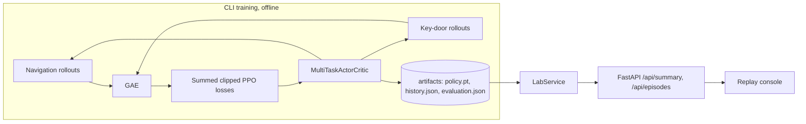
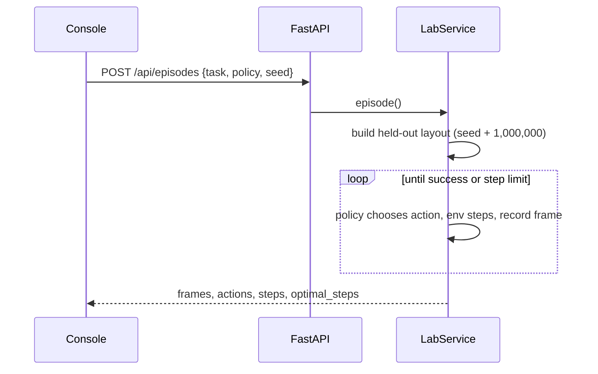

# Architecture

Training happens offline through the CLI and writes a small checkpoint. The API only loads it and runs inference on CPU, so the console responds instantly and never trains in a request.

