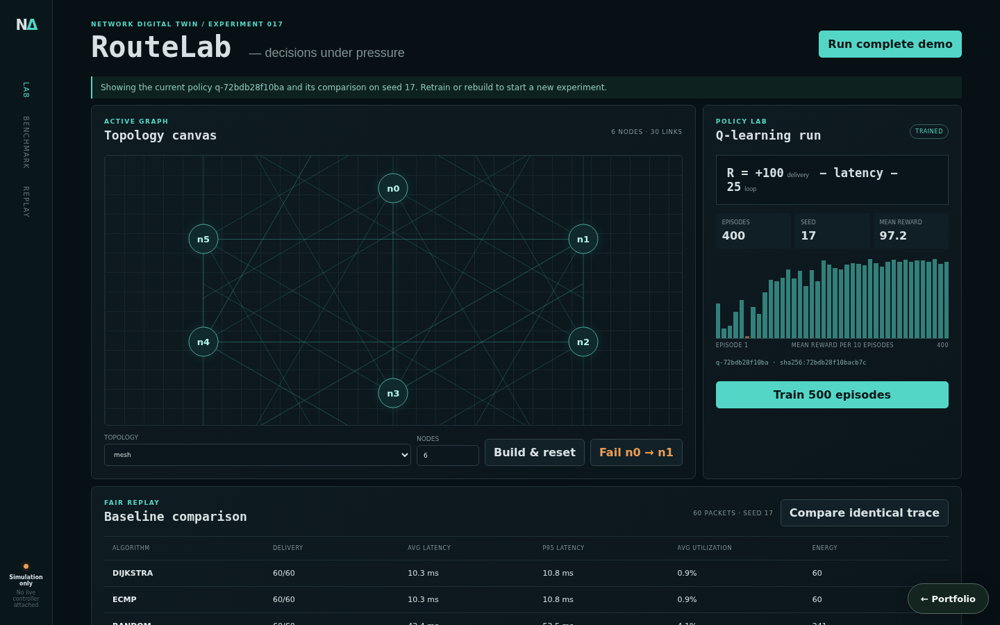

# Network Digital Twin and RL Routing Optimizer

A reproducible directed-network simulator that trains an actual tabular Q-learning policy, evaluates it fairly against weighted Dijkstra, seeded ECMP, and seeded random routing, and exposes link-failure replay through an experiment console.



## What works

- Ring, star, and mesh topologies with directed links, capacity, load, queue limits, utilization-dependent delay, loss, failure, and recovery.
- Weighted Dijkstra, ECMP, random simple-path, and separately trained Q-learning routing. `RL_AGENT` refuses inference until a policy has been trained.
- Versioned policy IDs and SHA-256 checksums, reward curves, fixed seeds, and an always-on local experiment registry.
- Fair comparison: each algorithm resets runtime state and replays the same generated source/destination trace.
- Delivery/drop, average and p95 latency, throughput, utilization, energy/hops, per-packet path, and drop-reason evidence.
- Optional MLflow export only when `MLFLOW_TRACKING_URI` is configured; local experiment history is complete without it.

## Run locally

```bash
python3 -m venv .venv
. .venv/bin/activate
pip install -r requirements.txt -r requirements-dev.txt
PYTHONPATH=src uvicorn network_digital_twin_rl_routing_optimizer.api.app:app --reload --port 8003
```

Run `npm install && npm run dev` in `frontend/`, or `docker compose up`, then open `http://localhost:5173`. **Run complete demo** builds a six-node mesh, trains 400 episodes with seed 17, and compares all four algorithms across the same 60-packet trace. When the console opens it restores the current policy's training run and latest comparison from the API, so a seeded lab is visible immediately. The reward chart plots mean episode reward in 40 consecutive blocks across the whole run, and **Fail n0 → n1** / **Recover n0 → n1** replay the comparison on the changed graph.

## Reward and policy

The local policy uses state `(current node, destination)` and an outgoing-neighbor action. Delivery earns `+100`; each hop pays its current weighted latency; revisiting a node pays `-25`. Epsilon decays to 0.05, Q updates use learning rate 0.25 and discount 0.9, and greedy inference refuses loops or missing actions. This transparent small-graph policy is deliberately auditable; it is not labeled PPO/DQN.

## Main API workflow

1. `POST /api/simulator/topology` builds and resets a graph.
2. `POST /api/train` returns policy version, checksum, seed, and reward curve.
3. `POST /api/compare` evaluates unique algorithms on one trace seed.
4. `POST /api/simulator/fail` and `/recover` change directed link availability.
5. `POST /api/route`, `/evaluate`, and `GET /api/simulator/state` expose decisions and replay evidence.
6. `GET /api/lab/latest` returns the current policy's training result and its most recent comparison (`null` until they exist; retraining clears the comparison, rebuilding the topology clears both).
7. `GET /api/dashboard/experiments` returns local training/evaluation history.

## Verification

```bash
PYTHONPATH=src python3 -m pytest tests/unit tests/integration
cd frontend && npm run build
```

Tests cover topology invariants, deterministic baseline paths, capacity/latency state, policy training/inference, identical-seed comparison, latest-result tracking, and failure recovery. See [architecture](docs/architecture.md) and [testing strategy](docs/testing-strategy.md).

## Claim boundary

This is a simulator. It does not connect to or modify a live controller. Results support experimental decision-making only; a real deployment requires telemetry calibration, safety constraints, controller integration, staged shadow evaluation, and independent approval.

## Persistence

State is in memory by default, so the project runs with no setup. Set `NETWORK_DIGITAL_TWIN_DATABASE_URL` to persist it:

```bash
NETWORK_DIGITAL_TWIN_DATABASE_URL=sqlite:///./.local/state.sqlite3                          # single file
NETWORK_DIGITAL_TWIN_DATABASE_URL=postgresql+psycopg2://<user>:<password>@<host>:5432/<db>   # PostgreSQL
```

On startup the service restores its collections (`experiments`); after every successful write request it saves the documents that changed, and deletes removed ones, in one transaction. `docker compose up` uses SQLite on a named volume. For PostgreSQL, copy `.env.example` to `.env`, choose a `POSTGRES_PASSWORD`, and run `docker compose -f docker-compose.yml -f compose.postgres.yml up`; Compose refuses to start without the password, and no credential is committed. `tests/integration/test_persistence_restart.py` proves that state written by one process is served by a fresh process; set `PERSISTENCE_TEST_DATABASE_URL` to run it against PostgreSQL.

Only the experiment registry persists. The simulator topology, trained Q-table, and latest results live in process memory; after a restart, **Run complete demo** (or the same API calls with seed 17) rebuilds them deterministically.
