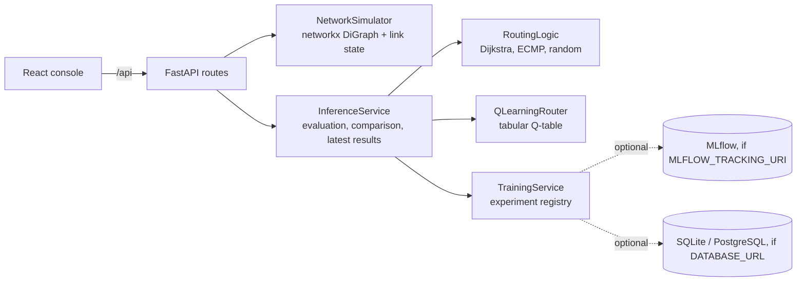

# Architecture

RouteLab is a single FastAPI process with in-memory state and a React console. Everything is a simulation: no controller, device, or live network is contacted.

## Components

| Module | Responsibility |
|---|---|
| `algorithms/simulator.py` | Builds ring, star, or mesh topologies as directed graphs; tracks per-link capacity, load, queue limit, loss rate, and failure; applies utilization-dependent delay (`base × (1 + 3u²)`) and decays load each step. |
| `algorithms/baselines.py` | Weighted Dijkstra, seeded ECMP over equal-cost shortest paths, seeded random simple path (cutoff 8). |
| `algorithms/q_learning.py` | Tabular Q-learning over `(current, destination, next hop)`; epsilon decays to 0.05; checksummed, versioned policy; loop-free greedy inference. |
| `services/inference_service.py` | Replays one seeded source/destination trace per algorithm after resetting runtime state; computes delivery, drops, average and p95 latency, utilization, throughput, and hop cost; remembers the current training run and its latest comparison. |
| `services/training_service.py` | Append-only experiment registry (training and evaluation records); optional MLflow export. |
| `api/routes.py` | REST contract (topology, fail/recover, train, route, evaluate, compare, `lab/latest`, experiments, demo seed). |

## Main workflow

1. `POST /api/simulator/topology` builds a graph and resets the policy, latest results, and registry.
2. `POST /api/train` trains a policy on the active graph and returns its version, checksum, and reward curve.
3. `POST /api/compare` replays the same seeded trace for each algorithm.
4. `POST /api/simulator/fail` / `recover` change a directed link; the console replays the comparison on the changed graph.
5. `GET /api/lab/latest` lets a console opened later show the current policy and comparison.

## State and persistence

By default all state is in process memory. With a database URL only the experiment registry is persisted; the topology, Q-table, and latest results are rebuilt with the seeded demo after a restart.

## Limits

- Small graphs only (3–100 nodes; the console allows up to 20); the tabular policy does not generalize across topologies.
- Latency, loss, and queueing are model parameters, not calibrated telemetry.
