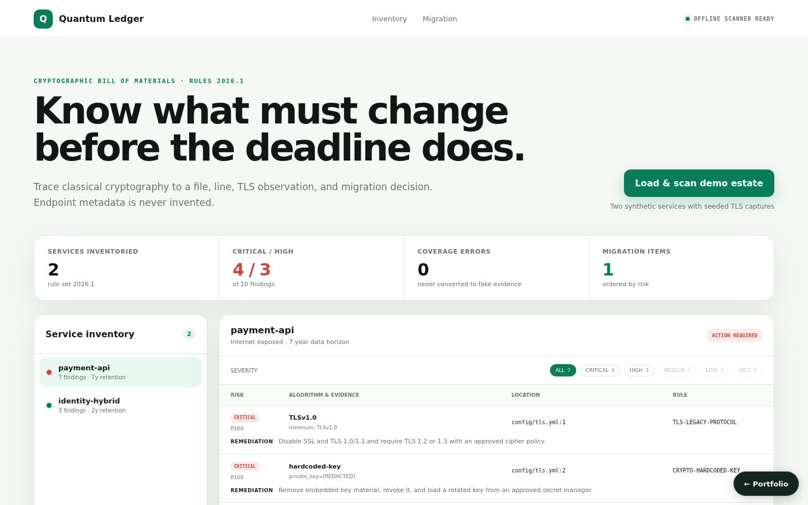
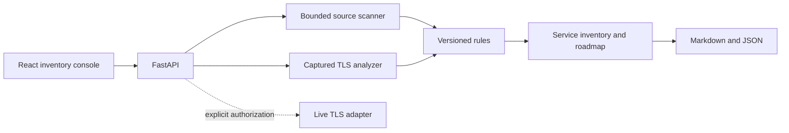

# Quantum Ledger — Post-Quantum Migration Scanner

**Project 10 · runnable full product · offline-first**



Quantum Ledger scans submitted source, configuration, manifests, and captured TLS observations into an evidence-backed cryptographic bill of materials. Findings retain file, line, redacted excerpt, confidence, rule version, quantum exposure, and remediation. Migration priority combines severity, internet exposure, and data-retention horizon.

## Product workflow

1. Submit one or more named services with bounded file content and TLS observations.
2. Detect weak hashes, embedded key material, classical asymmetric cryptography, TLS protocols, symmetric modes, and standardized PQC candidates.
3. Review service posture, evidence with its remediation, coverage errors, and the ordered migration plan; filter findings by severity.
4. Retrieve the stored scan and export Markdown or JSON (both are linked from the console).

Bare endpoint names never generate findings. Supply observed TLS metadata or invoke the explicitly authorized live-probe adapter. Probe failures become coverage errors, not invented cipher/certificate values.

## Run locally

```bash
python3 -m venv .venv
. .venv/bin/activate
pip install -r requirements.txt -r requirements-dev.txt
PYTHONPATH=src uvicorn post_quantum_crypto_migration_scanner.api.app:app --port 8011
```

```bash
cd frontend
npm install
npm run dev
```

Open `http://localhost:5173`, or use `docker compose up`. API docs are at `http://localhost:8011/docs`.

## Key API routes

- `POST /api/scan` — real content and observation scan
- `GET /api/scans` — stored scan summaries, newest first (empty until the first scan)
- `GET /api/dashboard` — latest stored inventory (`404` before the first scan)
- `GET /api/scans/{id}` — immutable scan evidence
- `GET /api/scans/{id}/export?format=markdown|json`
- `POST /api/tls/probe` — opt-in authorized network probe
- `POST /api/demo/seed` — scan the built-in demo estate

The built-in demo estate (`src/post_quantum_crypto_migration_scanner/demo.py`) is synthetic: a long-retention, internet-facing classical payment service and an internal hybrid migration candidate. Its file contents are invented, its hosts use the reserved `.example.test` domain, and its TLS values are labelled `seeded_capture` rather than presented as observations.

## Verification

```bash
PYTHONPATH=src pytest -q
cd frontend && npm run build
```

Tests cover rule mapping (including post-quantum signature names such as ML-DSA and SLH-DSA not being reported as classical exposure, and the `TLSv1` name live probes report for TLS 1.0), certificate-expiry findings, file/line evidence, secret redaction, strict mixed-posture logic, captured TLS analysis, non-fabrication, SSRF target rejection, the demo seed and scan listing, dashboard retrieval, roadmap ordering, and exports.

## Security and limitations

Uploaded text is scanned as data and never executed. The local API caps services, files, bytes, and evidence excerpts. Private key and secret-looking material is redacted. Live probing requires `authorized=true`, validates HTTPS, resolves the target, and blocks non-global address ranges; keep it disabled unless you own or are permitted to scan the endpoint.

Detection is conservative pattern analysis, not proof that a primitive is reachable or configured correctly. `is_quantum_safe` is true only when PQC evidence exists, no high/critical or quantum-vulnerable finding remains, and coverage has no error. Reports are held in memory by default and persist when a database URL is configured (see [Persistence](#persistence)).



See [`docs/`](docs/) for supporting architecture and demo material.

## Persistence

State is in memory by default, so the project runs with no setup. Set `PQC_SCANNER_DATABASE_URL` to persist it:

```bash
PQC_SCANNER_DATABASE_URL=sqlite:///./.local/state.sqlite3                          # single file
PQC_SCANNER_DATABASE_URL=postgresql+psycopg2://<user>:<password>@<host>:5432/<db>   # PostgreSQL
```

On startup the service restores its collections (`reports`); after every successful write request it saves the documents that changed, and deletes removed ones, in one transaction. `docker compose up` uses SQLite on a named volume. For PostgreSQL, copy `.env.example` to `.env`, choose a `POSTGRES_PASSWORD`, and run `docker compose -f docker-compose.yml -f compose.postgres.yml up`; Compose refuses to start without the password, and no credential is committed. `tests/integration/test_persistence_restart.py` proves that state written by one process is served by a fresh process; set `PERSISTENCE_TEST_DATABASE_URL` to run it against PostgreSQL.
