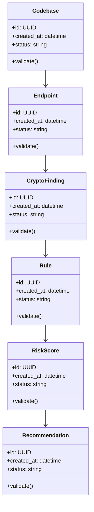

# Algorithms and Data Structures

## Algorithm Roadmap

| # | Algorithm | Implementation Requirement |
|---|---|---|
| 1 | evidence-based crypto pattern matching | Implemented with file and line provenance |
| 2 | TLS observation inventory | Implemented without endpoint-name fabrication |
| 3 | severity scoring | Implemented in the versioned rules engine |
| 4 | crypto-agility gap analysis | Implemented with strict mixed-posture logic |
| 5 | migration recommendation ranking | Implemented with exposure and retention factors |

## Core Data Structures

| Structure | Purpose | Notes |
|---|---|---|
| `CryptoFindingIndex` | Core data structure for Post-Quantum Crypto Migration Scanner | Document invariants and serialization format |
| `EndpointInventory` | Core data structure for Post-Quantum Crypto Migration Scanner | Document invariants and serialization format |
| `RuleSet` | Core data structure for Post-Quantum Crypto Migration Scanner | Document invariants and serialization format |
| `SeverityVector` | Core data structure for Post-Quantum Crypto Migration Scanner | Document invariants and serialization format |
| `MigrationPlan` | Core data structure for Post-Quantum Crypto Migration Scanner | Document invariants and serialization format |

## UML-Style Domain View

## Complexity Targets

- Prefer linear or near-linear processing for ingestion and validation steps.
- Use indexed lookup structures for repeated retrieval, policy, and ownership checks.
- Keep expensive AI/model calls outside tight loops.
- Cache deterministic intermediate results with versioned keys.

## Required Tests

- Happy-path unit tests for each algorithm.
- Boundary tests for empty input, malformed input, duplicate input, and large input.
- Regression tests for known failure modes.
- Deterministic seed tests for synthetic data, simulation, or model evaluation.
- Contract tests for serialized data structures.

## Implementation Notes

The first code milestone should implement the smallest useful vertical slice: parse or ingest input, run one core algorithm, persist the result, and expose it through a CLI or API endpoint.
