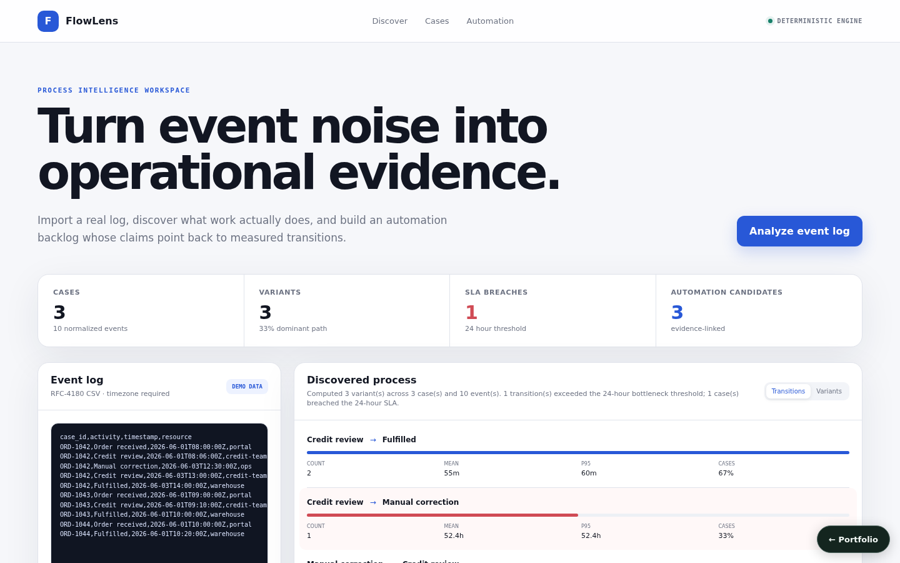
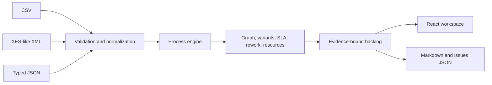

# FlowLens — Process Mining and Automation Analyzer

**Project 11 · runnable full product · offline-first**



FlowLens imports JSON, RFC-4180 CSV, or a safe XES-like XML subset into one deterministic process-mining pipeline. It calculates directly-follows transitions, variant coverage, mean/median/p95 delay, case durations, SLA breaches, rework, resource load, and handoffs. Recommendations are ordered and cite only computed evidence.

## Product workflow

1. Paste/import an event log containing case ID, activity, and timezone-aware timestamp; resource, lifecycle, cost, and event ID are optional.
2. Review accepted/rejected/duplicate data-quality counts.
3. Explore transitions, variants, bottlenecks, SLA cases, resources, and evidence-linked recommendations.
4. Retrieve the report and export Markdown or GitHub-Issues-compatible JSON.

The console edits and analyzes a CSV log, reopens the most recent stored report on arrival, shows accepted-data counts with the first rejected-row reasons, transitions (bottlenecks highlighted), variants, and the evidence-linked backlog, and downloads the Markdown report. SLA cases, resources, and handoffs are in the report JSON and exports. The editor starts with a small synthetic order-to-fulfilment log (`src/process_mining_workflow_automation_analyzer/demo.py`); its case IDs, timestamps, and resources are invented.

The narrative layer is deterministic and requires no model account. An external prose adapter can be added later without authority to create metrics.

## Run locally

```bash
python3 -m venv .venv
. .venv/bin/activate
pip install -r requirements.txt -r requirements-dev.txt
PYTHONPATH=src uvicorn process_mining_workflow_automation_analyzer.api.app:app --port 8012
```

```bash
cd frontend
npm install
npm run dev
```

Open `http://localhost:5173`, or run `docker compose up`. API docs are at `http://localhost:8012/docs`.

## Key API routes

- `POST /api/analyze` — typed JSON event analysis with SLA/bottleneck query policy
- `POST /api/import/csv` and `/api/import/xes` — validated import and analysis
- `GET /api/reports` and `/api/reports/{id}` — report history
- `GET /api/export/{id}?format=markdown|issues` — factual report or automation backlog
- `POST /api/demo/seed` — analyze the synthetic demo log through the CSV import path

## Metric semantics

- Events are ordered by case, UTC timestamp, event ID, then submitted position.
- Exact duplicate identities are removed and counted.
- Transition duration is the non-negative time to the next event; p95 uses linear interpolation.
- A bottleneck must meet configured frequency and exceed the absolute mean-duration threshold.
- Case duration is last minus first event; single-event cases are retained with zero duration.
- Rework counts activities repeated within a case.

## Verification

```bash
PYTHONPATH=src pytest -q
cd frontend && npm run build
```

Tests cover the demo seed, readable threshold labels, ordering, variants, percentiles, resources, rework, SLA evidence, CSV/XES parity, invalid-row reporting, XXE declaration rejection, Markdown evidence, and Issues export.

## Privacy and limitations

XML DTD/entity declarations are rejected, imports are capped at 5 MB/100,000 events, and raw files are not persisted. Resource is optional; pseudonymize it before import when identity is unnecessary. The algorithm measures observed logs and cannot infer work that source systems did not record. Reports live in memory by default and persist when a database URL is configured (see [Persistence](#persistence)).



See [`docs/`](docs/) for supporting architecture and demo material.

## Persistence

State is in memory by default, so the project runs with no setup. Set `PROCESS_MINING_DATABASE_URL` to persist it:

```bash
PROCESS_MINING_DATABASE_URL=sqlite:///./.local/state.sqlite3                          # single file
PROCESS_MINING_DATABASE_URL=postgresql+psycopg2://<user>:<password>@<host>:5432/<db>   # PostgreSQL
```

On startup the service restores its collections (`reports`); after every successful write request it saves the documents that changed, and deletes removed ones, in one transaction. `docker compose up` uses SQLite on a named volume. For PostgreSQL, copy `.env.example` to `.env`, choose a `POSTGRES_PASSWORD`, and run `docker compose -f docker-compose.yml -f compose.postgres.yml up`; Compose refuses to start without the password, and no credential is committed. `tests/integration/test_persistence_restart.py` proves that state written by one process is served by a fresh process; set `PERSISTENCE_TEST_DATABASE_URL` to run it against PostgreSQL.
