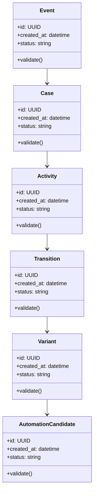

# Algorithms and Data Structures

## Algorithm Roadmap

| # | Algorithm | Implementation Requirement |
|---|---|---|
| 1 | directly-follows graph discovery | Implemented with deterministic ordering |
| 2 | variant frequency ranking | Implemented with case coverage |
| 3 | SLA breach detection | Implemented with per-case evidence |
| 4 | cycle/rework detection | Implemented with repeated-activity evidence |
| 5 | transition duration analysis | Implemented with mean, median, and p95 |

## Core Data Structures

| Structure | Purpose | Notes |
|---|---|---|
| `EventLog` | Core data structure for Process Mining and Workflow Automation Analyzer | Document invariants and serialization format |
| `CaseTrace` | Core data structure for Process Mining and Workflow Automation Analyzer | Document invariants and serialization format |
| `ProcessGraph` | Core data structure for Process Mining and Workflow Automation Analyzer | Document invariants and serialization format |
| `VariantIndex` | Core data structure for Process Mining and Workflow Automation Analyzer | Document invariants and serialization format |
| `BottleneckScore` | Core data structure for Process Mining and Workflow Automation Analyzer | Document invariants and serialization format |

## UML-Style Domain View

## Complexity Targets

- Prefer linear or near-linear processing for ingestion and validation steps.
- Use indexed lookup structures for repeated retrieval, policy, and ownership checks.
- Keep expensive AI/model calls outside tight loops.
- Cache deterministic intermediate results with versioned keys.

## Required Tests

- Happy-path unit tests for each algorithm.
- Boundary tests for empty input, malformed input, duplicate input, and large input.
- Regression tests for known failure modes.
- Deterministic seed tests for synthetic data, simulation, or model evaluation.
- Contract tests for serialized data structures.

## Implementation Notes

The first code milestone should implement the smallest useful vertical slice: parse or ingest input, run one core algorithm, persist the result, and expose it through a CLI or API endpoint.
