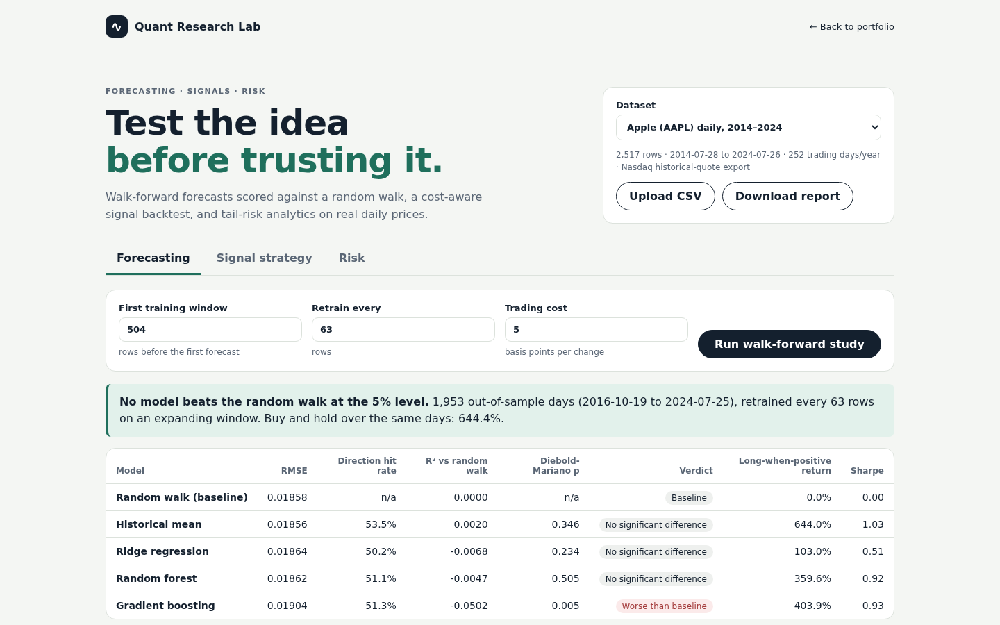

# Quant Research Lab

Test a market idea against a random walk before trusting it. The lab builds point-in-time features from daily prices, scores five forecasting models walk-forward against a random-walk baseline with Diebold-Mariano tests, backtests a composite trading signal with next-bar entry and trading costs, and measures tail risk with VaR, expected shortfall, GARCH(1,1), and a Hurst exponent.



**Status:** full local product with API, browser console, CLI report, and tests. It consolidates three earlier research scripts (a stock-price ensemble, a crypto volatility study, and "The Architect" BTC signal) and fixes the flaws that made their results unreliable. See [ADR 0001](docs/adr/0001-core-architecture.md).

## Results on the bundled data

AAPL daily, 2014–2024, 1,953 out-of-sample days (Oct 2016 to Jul 2024), retrained every 63 days:

| Model | RMSE | Direction hit rate | R² vs random walk | Diebold-Mariano p |
|---|---:|---:|---:|---:|
| Random walk (baseline) | 0.01858 | — | 0 | — |
| Historical mean | 0.01856 | 53.5% | +0.002 | 0.35 |
| Ridge | 0.01864 | 50.2% | −0.007 | 0.23 |
| Random forest | 0.01862 | 51.1% | −0.005 | 0.51 |
| Gradient boosting | 0.01904 | 51.3% | −0.050 | 0.005 (worse) |

No model beats the random walk at the 5% level, and gradient boosting is significantly worse. That is the expected result for a liquid stock with price-only features, and the point of the lab is to measure it honestly.

The TTPS signal on AAPL (10 bps per position change) returned 15.0% a year with 19.2% volatility and a −35.2% maximum drawdown, against 24.5%, 28.6%, and −38.7% for buy and hold. On one year of BTC the same signal lost 16.1% while buy and hold gained 53.9%.

## Run

From the portfolio root, `npm start` and open **Quant Research Lab**. Standalone, from this directory with Python 3.10+:

```bash
python3 -m pip install -r requirements-dev.txt
PYTHONPATH=src uvicorn quant_research_lab.api.app:app --port 8023
```

Open http://127.0.0.1:8023. Or with Docker, `docker compose up` serves the API on 8023 and the console on 5175.

Command-line report:

```bash
PYTHONPATH=src python3 -m quant_research_lab.cli aapl-daily          # or btc-daily
PYTHONPATH=src python3 -m quant_research_lab.cli path/to/prices.csv -o report.md
```

## API

| Method | Route | Purpose |
|---|---|---|
| `GET` | `/api/datasets` | Bundled and uploaded datasets |
| `POST` | `/api/datasets` | Upload a CSV (up to 2 MB; kept in memory) |
| `POST` | `/api/forecast` | Walk-forward study: `min_train`, `step`, `cost_bps`, `models` |
| `POST` | `/api/strategy` | TTPS backtest: four weights, `threshold`, `cost_bps` |
| `GET` | `/api/risk/{id}` | Distribution, VaR, expected shortfall, GARCH, Hurst |
| `GET` | `/api/report/{id}` | Markdown research report |

Accepted CSV formats: Nasdaq exports (`Date, Close/Last` with `$` prices, newest first), CoinMarketCap (`Start, End, …, Close, Volume`), CoinGecko (`snapped_at, price, total_volume`), or plain `Date, Close[, Volume]`. Weekend trading is detected to choose 365 or 252 periods per year.

## Tests

```bash
PYTHONPATH=src python3 -m pytest tests -q
```

22 tests, including direct checks that features and forecasts do not change when future data changes, and that GARCH recovers known parameters from simulated returns.

## What was fixed from the original scripts

- **Shuffled train/test split on a time series** → expanding-window walk-forward.
- **Same-day Open/High/Low used to predict that day's Close** → features use data up to the previous close only.
- **STL decomposition, scaler, and PCA fitted on all data (including the test set)** → every fit uses training rows only.
- **Newest-first data processed as if chronological** in "The Architect" → sorted before any indicator.
- **Placeholder PPO agent with a zero gradient** → removed; the composite signal is evaluated directly as a rule.
- **No costs and same-bar execution** → next-bar entry and per-change costs.
- **No baseline** → every model is compared with a random walk and a significance test.

## Scope

Research and education only. No live data, brokerage connection, or order execution. Results describe the past and are not investment advice. See [architecture](docs/architecture.md), [algorithms](docs/algorithms-and-data-structures.md), [testing strategy](docs/testing-strategy.md), [demo script](docs/demo-script.md), and the [backlog](BACKLOG.md).
