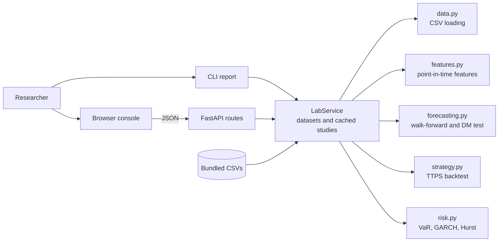
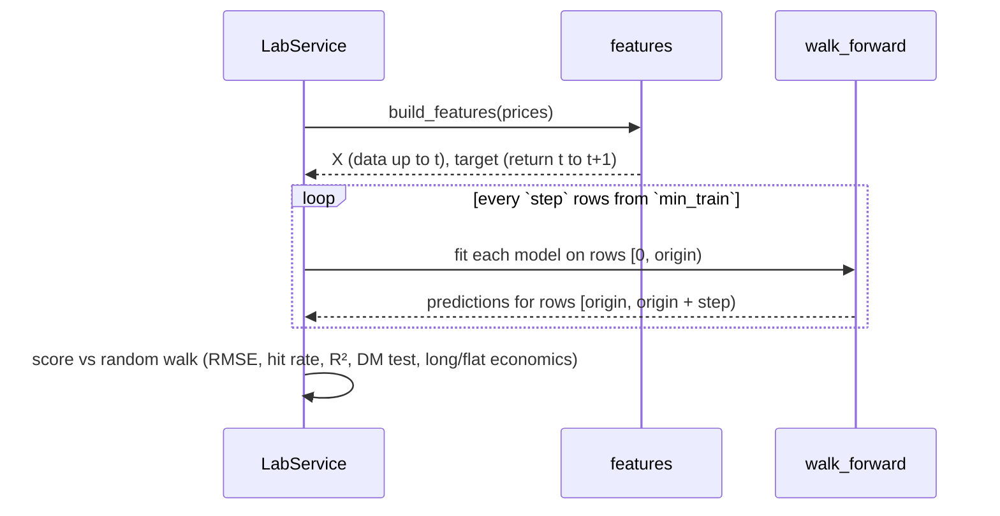

# Architecture

## System goal

Let someone test a price-forecasting or trading-signal idea in a way that cannot flatter it: no future data in features, out-of-sample scoring against a naive baseline, trading costs, and explicit tail risk.

## Context

## Walk-forward study

## State

Bundled datasets load at startup. Uploads and study results are kept in process memory and cleared on restart; results are cached by their full parameter set, so repeated runs are instant and identical.

## Boundaries

Research tool only: no brokerage connection, no live data feed, no order execution. See [ADR 0001](adr/0001-core-architecture.md).
