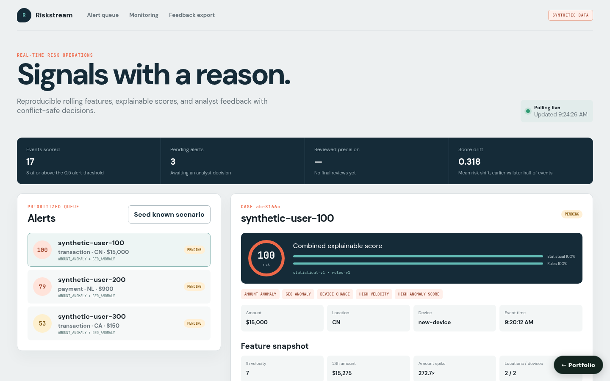

# Real-Time Fraud and Risk Stream Analytics

**Project 08 · Locally runnable product**



Riskstream ingests single or batched events, computes bounded event-time features, combines deterministic statistical and rule contributions, and supports conflict-safe analyst decisions. Seed data is explicitly synthetic and deterministic.

## Complete workflow

- Seed a fixed synthetic stream of 17 events for three users: a large purchase from a new country and device, a burst of failed logins followed by a foreign payment, and a borderline new-device purchase. Seeding resets local state and yields the same three prioritized alerts every time.
- Deduplicate stable event IDs and identify events arriving behind the five-minute live watermark.
- Compute 1h velocity/failures and 24h amount, locations, devices, amount-spike, geo, and device-change features without future leakage.
- Persist scores below the 0.5 alert threshold for monitoring; create prioritized alerts above it with reason codes, contributions, model version, and policy version.
- Browse alert detail and entity timeline, record actor/note/version analyst decisions (`pending` is rejected with 422; "needs more information" is not final), reject stale or immutable-final updates with 409, and export reviewed feedback as CSV.
- Track event/alert totals, reviewed precision and false-positive rate (over final true/false-positive decisions only; the console shows "—" until one exists), average risk, reason distribution, and score drift (absolute difference in mean risk between the earlier and later half of scored events, once at least four exist).
- Operate the full workflow in the responsive React analyst console with a synthetic-data badge.

## Run and verify

```bash
docker compose up --build
# UI: http://localhost:5173
# OpenAPI: http://localhost:8009/docs

PYTHONPATH=src pytest -q
cd frontend && npm run build
```

## Streaming and model boundary

The default `StreamProcessor` and repository are bounded process-local adapters for safe credential-free use. Scoring is real deterministic statistical/rule code, not a claim of a trained ML model. Kafka/Redpanda transport, durable feature/event storage, model registry, OIDC, and privacy-governed identifiers are deployment adapters; they are not silently simulated by local mode.

## Key files

- `algorithms/stream_processor.py` — event-time windows, lateness, and eviction
- `algorithms/scoring.py` — bounded explainable score contributions
- `services/analytics_service.py` — dedup, alerts, seed, and analyst state transitions
- `adapters/repositories.py` — timelines and correct monitoring denominators
- `frontend/src/App.tsx` — alert queue, feature evidence, decisions, and monitoring

## Persistence

State is in memory by default, so the project runs with no setup. Set `REAL_TIME_FRAUD_DATABASE_URL` to persist it:

```bash
REAL_TIME_FRAUD_DATABASE_URL=sqlite:///./.local/state.sqlite3                          # single file
REAL_TIME_FRAUD_DATABASE_URL=postgresql+psycopg2://<user>:<password>@<host>:5432/<db>   # PostgreSQL
```

On startup the service restores its collections (`alerts`, `events`, `scores`, `stream_history`, `stream_watermark`); after every successful write request it saves the documents that changed, and deletes removed ones, in one transaction. `docker compose up` uses SQLite on a named volume. For PostgreSQL, copy `.env.example` to `.env`, choose a `POSTGRES_PASSWORD`, and run `docker compose -f docker-compose.yml -f compose.postgres.yml up`; Compose refuses to start without the password, and no credential is committed. `tests/integration/test_persistence_restart.py` proves that state written by one process is served by a fresh process; set `PERSISTENCE_TEST_DATABASE_URL` to run it against PostgreSQL.
