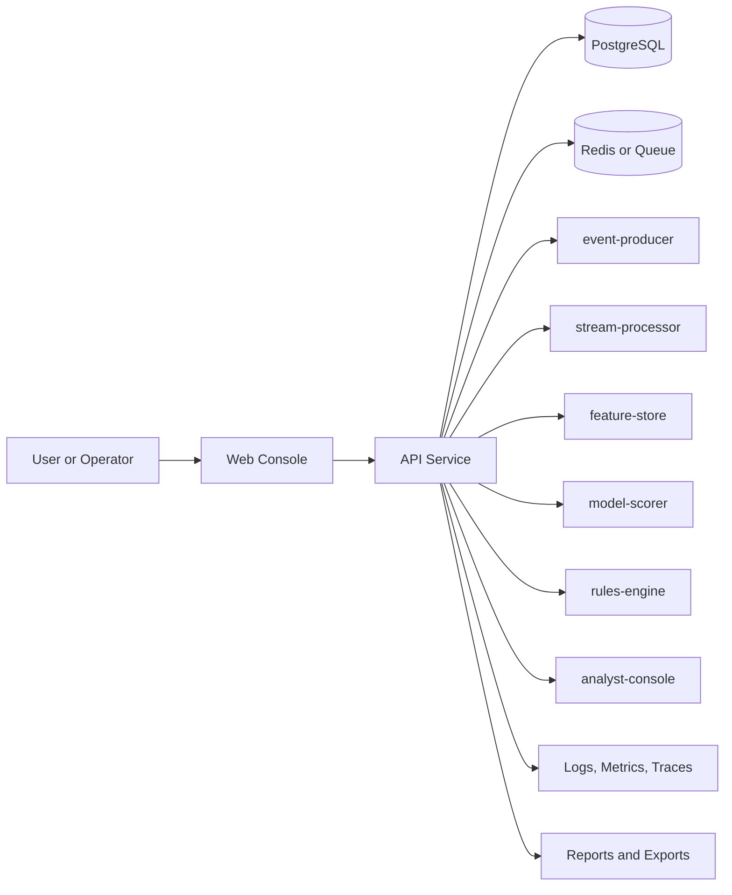
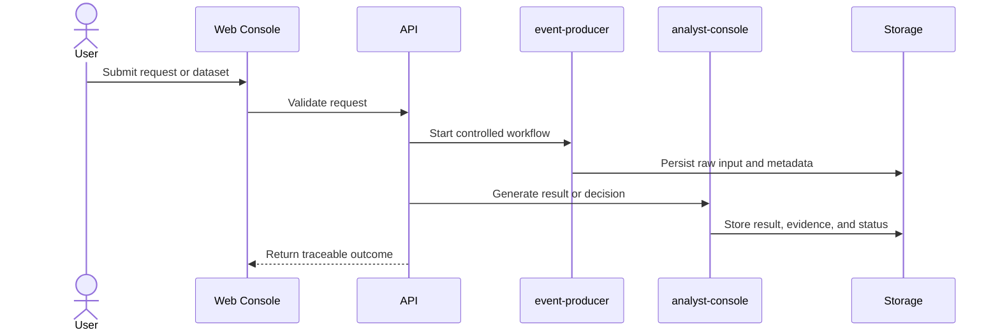
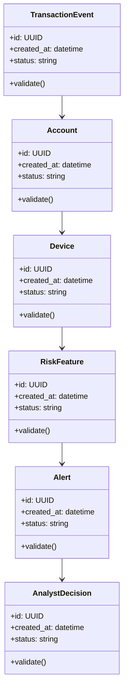

# Architecture

## System Goal

Generate transaction streams, compute risk features, detect anomalies, and support analyst review with reason codes.

## Context Diagram

## Main Workflow

## Domain Model

## Component Responsibilities

- `event-producer`: owns one bounded responsibility in the workflow.
- `stream-processor`: owns one bounded responsibility in the workflow.
- `feature-store`: owns one bounded responsibility in the workflow.
- `model-scorer`: owns one bounded responsibility in the workflow.
- `rules-engine`: owns one bounded responsibility in the workflow.
- `analyst-console`: owns one bounded responsibility in the workflow.

## Data and Control Boundaries

- Raw inputs are preserved before transformation.
- Validated records or decisions are separated from quarantined failures.
- Human approval or policy checks are explicit where automation can affect users, infrastructure, or security.
- Observability data is treated as a first-class output: logs, metrics, traces, decisions, and errors.

## Deployment Shape

- Local: Docker Compose with the FastAPI scoring/case API and functional React analyst console.
- CI: lint, unit tests, integration smoke test, dependency scan.
- Demo: seeded data plus deterministic walkthrough from `docs/demo-script.md`.

## Tradeoffs and Failure Modes

- Local transport/state adapters are explicit; durable streaming, storage, identity, and model-registry adapters are deployment extensions.
- External API dependencies must be optional in demos.
- AI-assisted outputs require evidence, validation, or human approval.
- Data and network claims must clearly identify synthetic, simulated, or public inputs.
