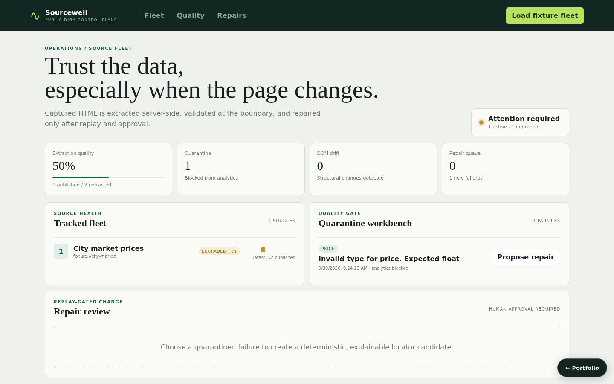

# Sourcewell — Self-Healing Public Data Intelligence Pipeline

An offline-first public-data operations product that performs real server-side CSS extraction, validates typed records, keeps invalid data out of analytics, fingerprints DOM drift, and activates selector repairs only after replay and explicit approval.



## What works

- Source registration with `https://`/fixture URL policy, typed schema, rate policy, and immutable recipe versions.
- BeautifulSoup CSS extraction from captured HTML, including repeated `_record` containers and `selector@attribute` values.
- Type normalization, field-level failures, quarantine, valid-only analytics, run quality, stored HTML/fingerprint, and drift detection.
- Deterministic repair candidates based on stable data/ARIA/id/class attributes.
- Replay that verifies selector coverage and schema conversion before a separate human-approved activation creates version 2.
- Fleet, run, valid-record, failure, recipe, proposal, dashboard, and seeded-demo APIs plus an operational web console. Each source row shows its active recipe version, whether its latest run quarantined records, and the published share of its last eight runs.

## Run locally

```bash
python3 -m venv .venv
. .venv/bin/activate
pip install -r requirements.txt -r requirements-dev.txt
PYTHONPATH=src uvicorn self_healing_public_data_intelligence_pipeline.api.app:app --reload --port 8002
```

Then run `npm install && npm run dev` in `frontend/`, or use `docker compose up`. Open `http://localhost:5173`, load the fixture fleet, inspect its quarantined price, propose a repair, replay corrected markup, and approve activation. The fixture fleet is one synthetic `fixture://city-market` page with two products, one of which has a deliberately invalid price. Loading it resets the workspace. State is in memory and resets on restart unless a database URL is configured (see [Persistence](#persistence)); captured HTML is stored with each run rather than in object storage.

## Main API workflow

1. `POST /api/sources` stores source, schema, and recipe version 1.
2. `POST /api/crawl` extracts from raw HTML. `extracted_data` remains an explicit fixture/import compatibility field; omitting it uses the production extraction path.
3. `GET /api/records/valid` excludes every quarantined record; `/api/failures` explains field errors.
4. `POST /api/repair/propose/{failureId}` creates an explainable candidate.
5. `POST /api/repair/replay/{proposalId}` checks field coverage and types on captured HTML.
6. `POST /api/repair/activate/{proposalId}` requires `approved: true` and a passing replay.

## Verification

```bash
PYTHONPATH=src python3 -m pytest tests/unit tests/integration
cd frontend && npm run build
```

Tests cover selector extraction, quarantine, fingerprinting, candidate ranking, failed/passing replay, activation guards, and the full API path. See [architecture](docs/architecture.md), [testing strategy](docs/testing-strategy.md), and [demo script](docs/demo-script.md).

## Responsible crawling boundary

The shipped workflow operates on supplied/seeded captures and makes no internet request. A network crawler must add robots evaluation, a descriptive User-Agent, DNS/redirect SSRF checks, response/time limits, and the configured per-domain limiter before it is enabled. The UI labels fixture mode explicitly. No repair can bypass replay and approval, and quarantined records never enter dashboard trend counts.

## Persistence

State is in memory by default, so the project runs with no setup. Set `SELF_HEALING_PUBLIC_DATA_INTELLIGENCE_PIPELINE_DATABASE_URL` to persist it:

```bash
SELF_HEALING_PUBLIC_DATA_INTELLIGENCE_PIPELINE_DATABASE_URL=sqlite:///./.local/state.sqlite3                          # single file
SELF_HEALING_PUBLIC_DATA_INTELLIGENCE_PIPELINE_DATABASE_URL=postgresql+psycopg2://<user>:<password>@<host>:5432/<db>   # PostgreSQL
```

On startup the service restores its collections (`sources`, `recipes`, `runs`, `records`, `failures`, `proposals`); after every successful write request it saves the documents that changed, and deletes removed ones, in one transaction. `docker compose up` uses SQLite on a named volume. For PostgreSQL, copy `.env.example` to `.env`, choose a `POSTGRES_PASSWORD`, and run `docker compose -f docker-compose.yml -f compose.postgres.yml up`; Compose refuses to start without the password, and no credential is committed. `tests/integration/test_persistence_restart.py` proves that state written by one process is served by a fresh process; set `PERSISTENCE_TEST_DATABASE_URL` to run it against PostgreSQL.
