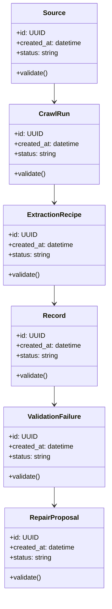

# Algorithms and Data Structures

## Implemented Algorithms

| # | Algorithm | Delivery Evidence |
|---|---|---|
| 1 | accessibility/data-attribute locator ranking | Implemented with deterministic candidate tests |
| 2 | typed schema validation and quarantine | Implemented with valid/invalid record separation tests |
| 3 | DOM fingerprint comparison | Implemented with captured-HTML drift tests |
| 4 | recipe replay and activation gating | Implemented with replay and approval transition tests |
| 5 | run quality and source health summaries | Implemented with fleet/dashboard workflow tests |

## Core Data Structures

| Structure | Purpose | Notes |
|---|---|---|
| `ExtractionRecipe` | Core data structure for Self-Healing Public Data Intelligence Pipeline | Document invariants and serialization format |
| `SelectorTrie` | Core data structure for Self-Healing Public Data Intelligence Pipeline | Document invariants and serialization format |
| `SourceHealthSeries` | Core data structure for Self-Healing Public Data Intelligence Pipeline | Document invariants and serialization format |
| `ValidationErrorQueue` | Core data structure for Self-Healing Public Data Intelligence Pipeline | Document invariants and serialization format |
| `RawArtifactStore` | Core data structure for Self-Healing Public Data Intelligence Pipeline | Document invariants and serialization format |

## UML-Style Domain View

## Complexity Targets

- Prefer linear or near-linear processing for ingestion and validation steps.
- Use indexed lookup structures for repeated retrieval, policy, and ownership checks.
- Keep expensive AI/model calls outside tight loops.
- Cache deterministic intermediate results with versioned keys.

## Required Tests

- Happy-path unit tests for each algorithm.
- Boundary tests for empty input, malformed input, duplicate input, and large input.
- Regression tests for known failure modes.
- Deterministic seed tests for synthetic data, simulation, or model evaluation.
- Contract tests for serialized data structures.

## Implementation Notes

The delivered workflow captures real fixture/HTTPS input, extracts and validates records, quarantines failures, detects DOM drift, replays repairs, and activates a new recipe only after approval.
