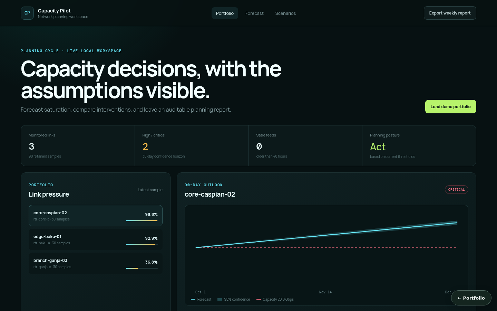

# Capacity Pilot — Smart Network Capacity Planner

An end-to-end local planning product for validated network telemetry, explainable capacity forecasts, saturation risk, budget-aware actions, saved what-if comparisons, and weekly report exports.



**Status:** Full viable local product. The default forecast is an explicit ordinary least-squares trend model; it is not presented as an ML model. Recommendations are planning candidates and do not make network changes.

## Product workflow

1. Load the deterministic three-link demo (synthetic telemetry generated in code, not captured from a network) or ingest typed telemetry.
2. Compare utilization, feed freshness, loss, latency, and device health.
3. Inspect a 7–90 day forecast with method, sample count, MAE, trend, confidence bounds, and warnings.
4. Review explainable saturation risk and budget-filtered actions.
5. Save capacity, growth, and traffic-reduction scenarios with baseline deltas.
6. Export a weekly Markdown or JSON planning report.

The React console implements the entire journey, including loading, empty, error, success, responsive, and keyboard-focus states. OpenAPI exposes the same capabilities for automation.

## Run locally

### Docker Compose

```bash
docker compose up
```

- Console: <http://localhost:5173>
- OpenAPI: <http://localhost:8014/docs>
- Readiness: <http://localhost:8014/ready>

Compose persists telemetry and scenarios in a SQLite database on the `state-data` volume; `compose.postgres.yml` switches to PostgreSQL (see [Persistence](#persistence)).

### Without Docker

```bash
python3 -m venv .venv
. .venv/bin/activate
pip install -r requirements-dev.txt
PYTHONPATH=src uvicorn smart_network_capacity_planner.api.app:app --port 8014 --reload
```

In a second terminal:

```bash
cd frontend
npm install
npm run dev
```

Set `CAPACITY_STATE_FILE=./.local/capacity-state.json` if the non-Docker API should retain data across restarts. With no path, the repository is deliberately ephemeral and ideal for tests.

## API surface

| Method | Route | Purpose |
|---|---|---|
| `POST` | `/api/demo/seed?reset=true` | Load reproducible multi-link history |
| `POST` | `/api/telemetry` | Validate and idempotently ingest a batch |
| `GET` | `/api/overview` | Portfolio KPIs and link quality summaries |
| `GET` | `/api/forecast/{link_id}` | Forecast, diagnostics, risk, and recommendations |
| `POST/GET` | `/api/what-if/{link_id}` | Save or list scenario comparisons |
| `GET` | `/api/reports/weekly?format=markdown` | Export weekly planning evidence |

Duplicate link/timestamp samples are idempotent when identical and return `409` when conflicting. Invalid values are rejected by the API before repository mutation.

## Forecast and risk behavior

- Samples are sorted by UTC timestamp; out-of-order ingestion is safe.
- The forecast fits a daily linear trend to observed utilization. A traffic scenario scales the fitted trend and current load.
- Confidence bounds use residual error with a conservative capacity-based floor for sparse histories.
- Risk combines confidence-bound threshold crossing, headroom, and current loss signals. The response includes the reasons.
- A budget does not hide an unaffordable upgrade: it returns it as excluded with the reason and keeps viable zero-capex actions visible.

## Verification

```bash
PYTHONPATH=src pytest -q
cd frontend && npm run build && npm run lint
docker compose config --quiet
```

Tests cover observed/sparse trends, risk, budget constraints, validation, idempotency/conflicts, seeding, scenario persistence, and Markdown reporting.

## Operational boundaries

- This repository is a planning aid, not a network controller. All actions require human change control.
- The JSON file adapter provides single-process local durability. A multi-replica deployment should implement the same repository interface with TimescaleDB/PostgreSQL and transactional uniqueness on `(link_id, timestamp)`.
- Linear trend is interpretable and deterministic but does not model seasonality or structural breaks. Diagnostics and sparse-history warnings keep this limitation visible.
- The UI uses demo identity-free data; production deployments should add SSO/RBAC at the gateway.
- Payload limits, authentication, TLS, database backups, metrics scraping, and retention policies belong in the deployment environment before internet exposure.

See [architecture](docs/architecture.md), [algorithm notes](docs/algorithms-and-data-structures.md), and the [testing strategy](docs/testing-strategy.md) for deeper design context.

## Persistence

State is in memory by default, so the project runs with no setup. Set `CAPACITY_PLANNER_DATABASE_URL` to persist it:

```bash
CAPACITY_PLANNER_DATABASE_URL=sqlite:///./.local/state.sqlite3                          # single file
CAPACITY_PLANNER_DATABASE_URL=postgresql+psycopg2://<user>:<password>@<host>:5432/<db>   # PostgreSQL
```

On startup the service restores its collections (`telemetry`, `scenarios`); after every successful write request it saves the documents that changed, and deletes removed ones, in one transaction. `docker compose up` uses SQLite on a named volume. For PostgreSQL, copy `.env.example` to `.env`, choose a `POSTGRES_PASSWORD`, and run `docker compose -f docker-compose.yml -f compose.postgres.yml up`; Compose refuses to start without the password, and no credential is committed. `tests/integration/test_persistence_restart.py` proves that state written by one process is served by a fresh process; set `PERSISTENCE_TEST_DATABASE_URL` to run it against PostgreSQL.

The older JSON-file option still works for single-process use; prefer the database URL, and do not enable both.
