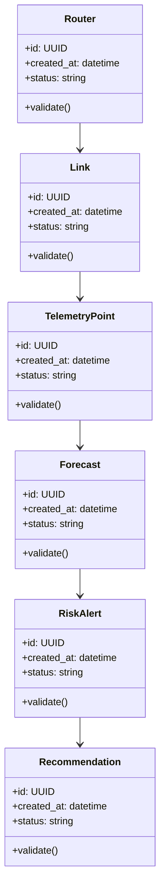

# Algorithms and Data Structures

## Implemented Algorithms

| # | Algorithm | Delivery Evidence |
|---|---|---|
| 1 | ordinary-least-squares utilization trend | Implemented with observed, flat, declining, and sparse histories |
| 2 | residual confidence bounds with sparse-data floor | Implemented with explicit diagnostics and warnings |
| 3 | confidence-bound saturation risk | Implemented with headroom, latency/loss evidence, and horizon crossing |
| 4 | budget-aware recommendation selection | Implemented with selected/excluded reasons and zero-capex mitigation |
| 5 | persisted baseline-versus-scenario comparison | Implemented with capacity, growth, traffic, and risk deltas |

## Core Data Structures

| Structure | Purpose | Notes |
|---|---|---|
| `TimeSeriesWindow` | Core data structure for Smart Network Capacity Planner | Document invariants and serialization format |
| `CapacityGraph` | Core data structure for Smart Network Capacity Planner | Document invariants and serialization format |
| `ForecastResult` | Core data structure for Smart Network Capacity Planner | Document invariants and serialization format |
| `RiskRank` | Core data structure for Smart Network Capacity Planner | Document invariants and serialization format |
| `ScenarioPlan` | Core data structure for Smart Network Capacity Planner | Document invariants and serialization format |

## UML-Style Domain View

## Complexity Targets

- Prefer linear or near-linear processing for ingestion and validation steps.
- Use indexed lookup structures for repeated retrieval, policy, and ownership checks.
- Keep expensive AI/model calls outside tight loops.
- Cache deterministic intermediate results with versioned keys.

## Required Tests

- Happy-path unit tests for each algorithm.
- Boundary tests for empty input, malformed input, duplicate input, and large input.
- Regression tests for known failure modes.
- Deterministic seed tests for synthetic data, simulation, or model evaluation.
- Contract tests for serialized data structures.

## Implementation Notes

The delivered workflow validates and deduplicates telemetry, forecasts each link, explains risk, saves comparable interventions, and exports JSON/Markdown weekly reports.
