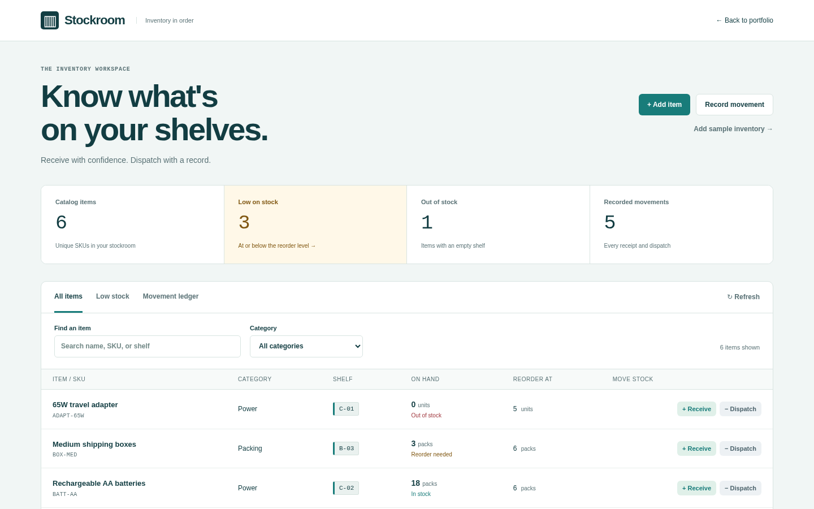

# Stockroom Inventory

A local inventory catalog with receiving, dispatching, low-stock alerts, and a persistent movement ledger. Stock changes and ledger entries commit in one SQLite transaction. Concurrent dispatches cannot drive stock below zero. Repeated movement requests with the same UUID are safe to retry.



## Run locally

From this directory, with Python 3.10+:

```sh
python3 -m pip install -r requirements.txt
PYTHONPATH=src python3 -m uvicorn stockroom_inventory.api.app:app --host 127.0.0.1 --port 8022
```

Open http://127.0.0.1:8022. **Add sample inventory** adds six representative items once; existing items, including matching SKUs, are preserved. The portfolio hub serves the frontend at `/demos/stockroom-inventory/` and API at `/api/projects/stockroom-inventory/api`.

Data persists in `.local/data/inventory.sqlite3`; override with `STOCKROOM_INVENTORY_DB`. The factory `create_app(db_path=...)` provides isolated test databases.

```sh
PYTHONPATH=src python3 -m pytest tests -q
```

### Docker Compose

```sh
docker compose up
```

The API runs on http://127.0.0.1:8022 and an nginx container serves the console on http://127.0.0.1:5174, forwarding `/api` to the API. Data persists in a named volume.

### Tests

`tests/unit` covers validation contracts and `tests/integration` covers HTTP workflows, concurrency, and persistence. Browser workflows for both business apps run with `npm run test:business` from the portfolio root.

See [architecture](docs/architecture.md), [algorithms](docs/algorithms-and-data-structures.md), [testing strategy](docs/testing-strategy.md), [demo script](docs/demo-script.md), and the [backlog](BACKLOG.md).

## API and scope

- `GET /health`: storage reachability.
- `GET /api/items`: searchable catalog (`q`, `category`, `low_stock`) and workspace summary.
- `POST /api/items`: create an item; positive opening stock receives an initial ledger entry.
- `GET /api/items/{id}` / `PATCH /api/items/{id}`: read or edit catalog fields; edits require the latest `version`.
- `GET /api/movements`: latest movements; accepts `item_id`, `kind`, and `limit` (maximum 200), returns the total matching count.
- `POST /api/movements`: receive or dispatch; requires `item_id`, `kind`, positive integer `quantity`, and `reason`. Optional `reference` and UUID `request_id`.
- `POST /api/demo/seed`: idempotent optional samples.

SKU is unique and immutable. The unit label is also immutable so historical balances retain their meaning; create a separate SKU for a different unit. Every subsequent quantity change goes through the ledger. Quantities use whole units only, with a per-item maximum of 1,000,000. An item is low on stock when quantity is at or below its reorder level. Different units are not added together in the dashboard. The UI shows the latest 50 movements and offers item filtering; the API returns up to 200. There are no purchases, accounting valuations, reservations, authentication, or cloud sync. This is a single-user localhost application; keep the service bound to 127.0.0.1.
