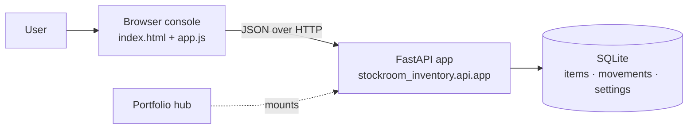
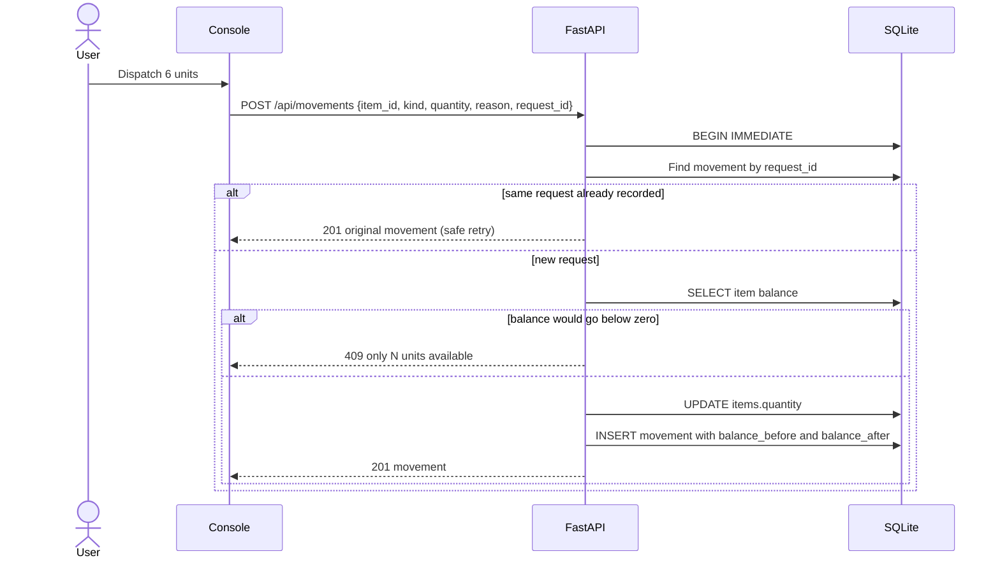

# Architecture

## System goal

Keep an accurate count of stock on hand, where every change is explained by a ledger entry and no sequence of requests can produce a negative balance.

## Context

The console is plain HTML, CSS, and a browser module with no build step. It detects whether it runs standalone (`/api`) or inside the portfolio hub (`/api/projects/stockroom-inventory/api`).

## Recording a movement

## Data model

| Table | Purpose |
|---|---|
| `items` | Catalog and current balance; `CHECK (quantity >= 0 AND quantity <= 1000000)`; SKU unique, case-insensitive |
| `movements` | Append-only ledger; `request_id` is `UNIQUE`; `CHECK (balance_after >= 0)` |
| `settings` | Flags such as `demo_seeded` |

## Boundaries

Single-user, localhost only. No purchasing, valuation, reservations, authentication, or cloud sync. See [ADR 0001](adr/0001-core-architecture.md).
