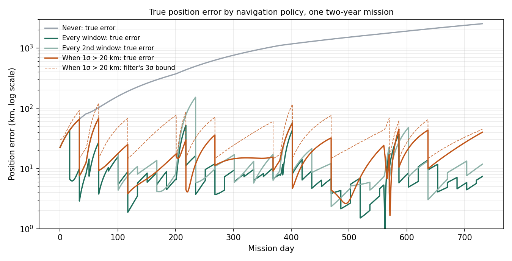

# ASP-1

An autonomy simulator for a deep-space probe that has too little power to stay awake and too little bandwidth to send everything. At 100 AU a round trip to Earth takes about 28 hours, so the probe must decide for itself when to sleep, when to spend scarce energy on navigation, and which observations deserve the downlink.



## What it decides, and how well

Every run is a two-year mission. A small energy source charges a store while the probe sleeps; when a full working window is affordable (every 16.7 days) it wakes for two hours. In each window it either spends an hour on an X-ray pulsar navigation fix and the rest on science, or gives the whole window to science. Four trajectory-correction burns, each with a small unknown execution error, happen along the way.

### 1. When to navigate

<!-- navigation:start -->
| Policy | Fixes per year | Mean error (km) | 95th-percentile error (km) | Science frames per year | Mean NEES |
|---|---:|---:|---:|---:|---:|
| Never | 0.0 | 1016 ± 148 | 2363 ± 355 | 7,635 | 8.8 |
| Every 4th window | 5.0 | 34 ± 2 | 117 ± 13 | 6,713 | 9.6 |
| Every 2nd window | 10.5 | 15 ± 1 | 48 ± 4 | 5,700 | 9.5 |
| Every window | 21.5 | 9 ± 0 | 22 ± 1 | 3,672 | 9.0 |
| When 1σ > 50 km | 3.5 | 37 ± 3 | 98 ± 7 | 6,990 | 9.9 |
| When 1σ > 20 km | 6.0 | 21 ± 1 | 49 ± 3 | 6,529 | 9.2 |

Means over 20 seeded two-year missions with 95% confidence intervals. Every policy faces the same trajectories, burns, and frames. A consistent 9-state filter has a mean NEES near 9; lower means its reported uncertainty is cautious.
<!-- navigation:end -->

- **Triggered beats scheduled:** navigating only when the filter's 1σ exceeds 20 km matches the tail error of fixing every second window (95th percentile 49 km against 48 km) with 43% fewer fixes (6.0 against 10.5 a year), which leaves 15% more science frames.
- **Never navigating** lets the error drift past 1,000 km on average and 2,300 km at the tail, mostly from burn execution errors and the unmodelled acceleration.
- **The filter's uncertainty is honest:** mean NEES stays between 8.8 and 9.9 for every policy, against 9 for a perfectly consistent filter.

Fixing every window gives the best position knowledge but halves the science. The uncertainty-triggered policy checks the onboard filter's own covariance (the log-determinant of the position block) at each wake and navigates only when it has grown past a limit, which mostly happens after burns.

### 2. What to send

<!-- gate:start -->
| Threshold | Gate (bits/frame) | Word indices | LZW per frame | LZW whole window | Raw text | Novel anomalies flagged | Unusual combinations flagged | False alarms |
|---:|---:|---:|---:|---:|---:|---:|---:|---:|
| 4 | **27.9** | 51.0 | 249.0 | 21.6 | 228.5 | 100% | 100% | 4.88% |
| 6 | **16.5** | 40.5 | 249.0 | 21.6 | 228.5 | 100% | 100% | 0.00% |
| 8 | **16.5** | 40.5 | 249.0 | 21.6 | 228.5 | 100% | 100% | 0.00% |
| 12 | **15.8** | 39.9 | 249.0 | 21.6 | 228.5 | 100% | 74% | 0.00% |
| 16 | **15.8** | 39.9 | 249.0 | 21.6 | 228.5 | 100% | 74% | 0.00% |
| 24 | **15.3** | 39.3 | 249.0 | 21.6 | 228.5 | 100% | 43% | 0.00% |

100,000 held-out frames (3% anomalies) against models trained only on routine frames; every frame decoded exactly.
<!-- gate:end -->

- **Result:** at the default threshold of 8, each frame costs 16.5 bits: 13.8× less than raw text and 24% less than LZW over the whole window, with every anomaly flagged, no false alarms, and every frame decoded exactly. A threshold of 4 starts flagging routine frames; above 8, unusual combinations begin to slip through.
- **Gate:** a bigram language model trained only on routine telemetry scores each frame. Routine frames are arithmetic-coded with that same model and decoded exactly on the ground; frames that are surprising or contain an unknown word are sent verbatim (LZW) and flagged. Both paths are lossless, so the gate trades bandwidth, never fidelity.
- **Baselines:** raw text, LZW per frame, fixed-width word indices, and LZW over the whole window. LZW over a whole window compresses repetitive telemetry well, but one lost packet corrupts everything after it and nothing is prioritised; the gate codes every frame independently and still sends fewer bits.
- **Unusual combinations** use only routine words in combinations never seen in training ("bus voltage background quiet"). They are harder to catch than new words, and the threshold sweep shows where they start to slip through.

### 3. How to point

<!-- slews:start -->
- 100 of 100 random slews (mean 120°) settled within 0.05° and 0.01°/s, in 85 s on average: 1.66× the bang-bang lower bound (95th percentile 1.79×).
- Peak wheel momentum 4.0 N·m·s of the 20 available; total angular momentum drifted by at most 3e-14 N·m·s.
<!-- slews:end -->

The controller rotates about the single eigenaxis between the current and target attitudes, with a rate limit and gyroscopic compensation, using four reaction wheels in a pyramid. The lower bound is the rest-to-rest bang-bang time about that axis at the wheels' full torque.

## Model

| Part | Implementation |
|---|---|
| Orbit | Heliocentric two-body motion from 100 AU at 17 km/s, velocity-Verlet integration, plus an unmodelled constant acceleration of about 5 × 10⁻¹⁰ m/s² (the scale of the Pioneer anomaly) |
| Navigation filter | 9-state Kalman filter (position, velocity, acceleration bias) with linearised gravity-gradient propagation, exact discrete process noise, and Joseph-form updates; position fixes have 5 km (1σ) noise per axis |
| Consistency | The truth model draws its noise from the filter's own noise model, so normalized estimation error squared (NEES) can check that the filter's uncertainty is honest |
| Attitude | Rigid body with four reaction wheels, J·ω̇ = −A·ḣ − ω × (J·ω + A·h), RK4 integration, per-wheel torque and momentum limits |
| Power | Energy store charged at 0.2 W; a 2-hour window at 40 W needs 288 kJ, so the wake period is 16.7 days (duty cycle 0.5%) |
| Telemetry | Templated frames from ten subsystems; 3% anomalies, of which 70% contain new words and 30% are unusual combinations of routine words |

This is a research simulator, not flight software. Orbits are two-body, sensors other than the position fix are idealised, and the telemetry language is synthetic.

## Run

Python 3.10+:

```bash
python3 -m venv .venv && . .venv/bin/activate
pip install -r requirements-dev.txt
python -m pytest -q                                  # 28 tests
python -m asp1 mission --policy "When 1σ > 20 km"   # one mission with its event log
python -m asp1 experiments                           # every number above (about 10 minutes on 8 cores)
python scripts/render_results.py                     # rewrite the README tables from docs/results.json
```

## Tests

- **Physics:** torque-free tumbling conserves angular momentum and energy; wheel torque only exchanges momentum between wheels and body; wheel limits scale commands without changing their direction and stop at saturation; slews settle within 2.5× the lower bound.
- **Navigation:** the discrete process noise matches a Monte Carlo of white acceleration; the orbit integrator conserves energy over a year; uncertainty grows without fixes and collapses with one; mean NEES over 120 independent runs falls inside the χ² 99% interval.
- **Telemetry:** LZW and arithmetic coding round-trip exactly, and the arithmetic code stays within 3 bits of the model's information content; unknown words always go verbatim.
- **Mission:** the number of windows and the energy spent match the power budget; every policy faces the same burns; navigating more buys accuracy with science; runs are deterministic.

## Layout

```text
asp1/
  physics.py      quaternions, rigid body, reaction wheels
  control.py      eigenaxis slew controller and its lower bound
  navigation.py   orbit truth model and Kalman filter
  power.py        energy store and duty cycle
  telemetry.py    frame source, bigram model, arithmetic coder, LZW, downlink gate
  mission.py      the sleep-wake-decide loop and navigation policies
  experiments.py  the three studies behind this README
tests/            28 tests
docs/             results.json, CSV tables, and the figure
```

## License

GPL-3.0. See [LICENSE](LICENSE).
